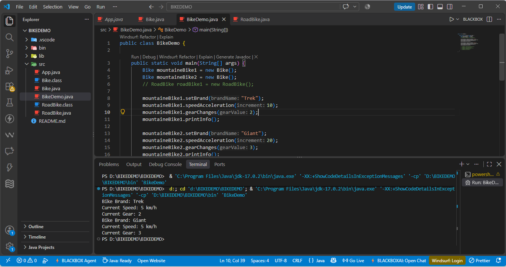
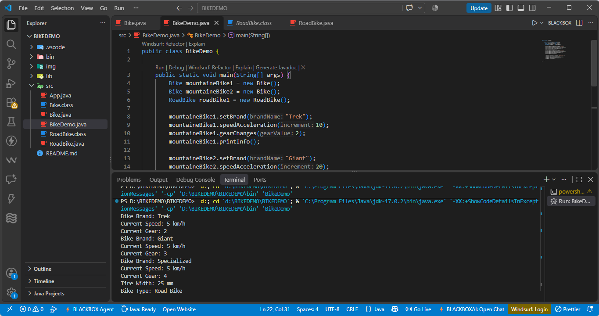
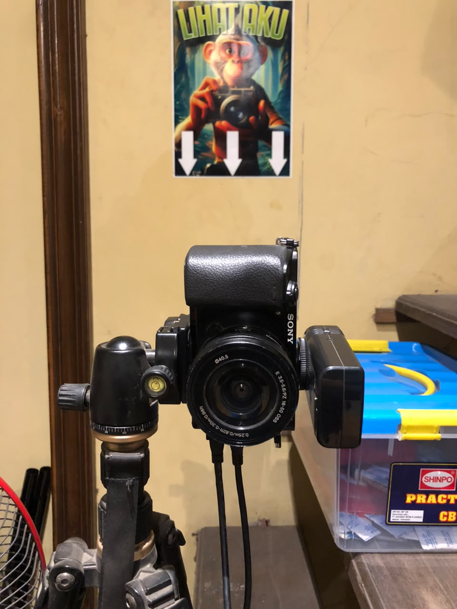
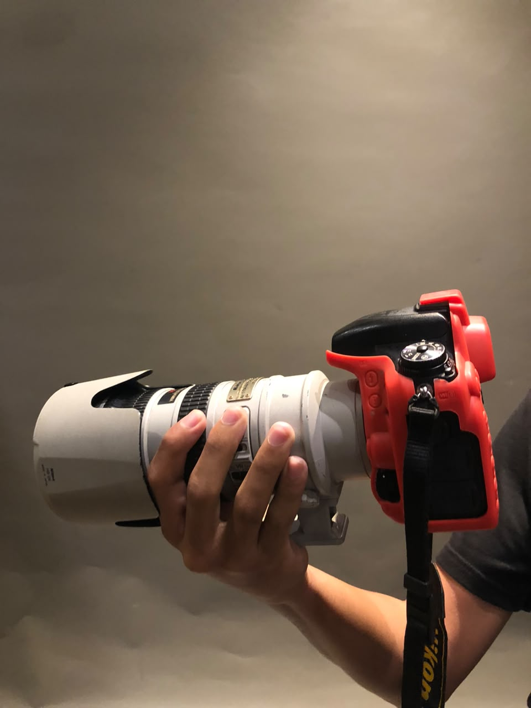
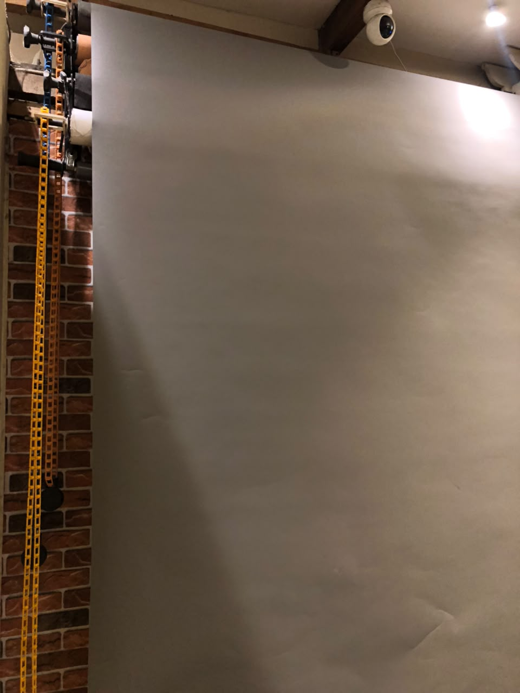
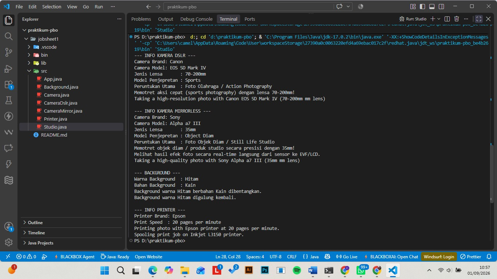

# Pengantar Konsep Pemrograman Berorientasi Objek - JOBSHEET 1

**1. Kompetensi**
Setelah menempuh materi percobaan ini, mahasiswa mampu mengenal:
Perbedaan paradigma berorientasi objek dengan paradigma struktural
Konsep dasar PBO

**2. Pendahuluan**

**2. 1 Pemrograman prosedural vs berorientasi objek**
Perbedaan mendasar antara pemrograman prosedural dengan pemrograman berorientasi objek (PBO) adalah: Pada pemrograman prosedural, program dipecah kedalam sub-program atau fungsi. Sedangkan pada PBO, program dipecah kedalam object, dimana objek tersebut membungkus state dan method.
Kelebihan PBO adalah program dapat lebih fleksibel dan modular, jika ada perubahan fitur, maka dapat dipastikan keseluruhan program tidak akan terganggu. Berbeda dengan prosedural, perubahan sedikit fitur saja kemungkinan dapat mengganggu keseluruhan program.

**2. 2 Konsep dasar PBO**
**Didalam PBO dikenal beberapa aspek, yaitu:**
**a. Object**
Object adalah suatu rangkaian dalam program yang terdiri dari state dan behaviour. Object pada software dimodelkan sedemikian rupa sehingga mirip dengan objek yang ada di dunia nyata. Objek memiliki state dan behaviour. State adalah ciri-ciri atau atribut dari object tersebut. Misal object Sepeda, memiliki state brand, speed, gear dan sebagainya. Sedangkan behaviour adalah perilaku yang dapat dilakukan object tersebut. Misal pada Sepeda, behaviournya antara lain, speed changes, gear changes, brake dan lain sebagainya.

**b. Class**
Class adalah blueprint atau prototype dari object. Ambil contoh object sepeda. Terdapat berbagai macam sepeda di dunia, dari berbagai merk dan model. Namun semua sepeda dibangun berdasarkan blueprint yang sama, sehingga setiap sepeda memiliki komponen dan karakteristik yang sama. Sepeda yang anda miliki dirumah, adalah hasil instansiasi dari class sepeda.

**c. Enkapsulasi**
Disebut juga dengan information-hiding. Dalam berinteraksi dengan objek, seringkali kita tidak perlu mengetahui kompleksitas yang ada didalamnya. Contoh pada sepeda, ketika kita mengganti gear pada sepeda, kita tinggal menekan tuas gear yang ada di grip setang sepeda saja. Kita tidak perlu mengetahui bagaimana cara gear berpindah secara teknis.

**d. Inheritance**
Disebut juga pewarisan. Inheritance memungkinkan kita untuk mengorganisir struktur program dengan natural. Inheritance juga memungkinkan kita untuk memperluas fungsionalitas program tanpa harus mengubah banyak bagian program. Contoh di dunia nyata, objek sepeda dapat diturunkan lagi ke model yang lebih luas, misal sepeda gunung (mountain bike) dan road bike. Dimana masing-masing dapat memiliki komponen tambahan, misal sepeda gunung memiliki suspensi, yang tidak dimiliki sepeda biasa. Dalam hal ini, objek mountain bike dan road bike mewarisi objek sepeda.

**e. Polimorfisme**
Polimorfisme juga meniru sifat objek di dunia nyata, dimana sebuah object dapat memiliki bentuk, atau menjelma menjadi bentuk-bentuk lain. Misalkan saja objek pesawat terbang. Objek ini dapat diwariskan menjadi pesawat jet dan pesawat baling-baling. Keduanya memiliki kemampuan untuk menambah kecepatan. Namun secara teknis, metode penambahan kecepatan antara pesawat jet dengan baling-baling tentu berbeda, karena masing-masing memiliki jenis mesin yang berbeda.

**3. Percobaan**
**Percobaan 1**
Didalam percobaan ini, kita akan mendemonstrasikan bagaimana membuat class, membuat object, kemudian mengakses method di dalam class tersebut.
1. Buka Netbeans atau menggunakan editor java, buat project BikeDemo.
2. Buat class Bike. Klik kanan pada package BikeDemo – New – Java Class.
3. Ketikkan kode class Bike dibawah ini.
4. Kemudian pada class main, ketikkan kode berikut ini.
5. Cocokkan hasilnya:

**Percobaan 2**
Didalam percobaan ini, akan didemonstrasikan salah satu fitur yang paling penting dalam PBO, yaitu inheritance. Disini kita akan membuat class RoadBike untuk kelas sepeda balap yang mana adalah turunan/warisan dari class Bike. Pada dasarnya class RoadBike adalah sama dengan class Bike, hanya saja pada road bike terdapat lebar ban. Untuk itu kita tidak perlu membuat class Sepeda Gunung dari nol, tapi kita wariskan saja class Sepeda ke class SepedaGunung.
Penjelasan lebih detail tentang inheritance akan dibahas pada modul selanjutnya.
1. Masih pada project BikeDemo. Buat class RoadBike.
2. Tambahkan kode extends Bike pada deklarasi class RoadBike. Kode extends ini menandakan bahwa class RoadBike mewarisi class Bike.
3. Kemudian lengkapi kode RoadBike seperti berikut ini:
4. Kemudian pada class main, tambahkan kode berikut ini:
5. Cocokkan hasilnya:

**4. Kesimpulan**
Dari percobaan di atas, kita telah mendemonstrasikan bagaimana paradigma pemrograman berorientasi objek dan mengimplementasikannya kedalam program sederhana. Kita juga telah mendemonstrasikan salah satu fitur paling penting dari PBO yaitu inheritance, yaitu dalam hal membuat class RoadBike.
Kita ketahui bahwa RoadBike pada dasarnya adalah sama dengan Bike (memiliki gear, memiliki kecepatan, dapat menambah kecepatan, dapat mengerem, pindah gigi) namun ada fitur tambahan yaitu lebar ban. Maka kita tidak perlu membuat class RoadBike dari nol, kita extends atau wariskan saja dari class Bike, kemudian kita tinggal tambahkan fitur yang sebelumnya belum ada di class Bike. Inilah salah satu kelebihan PBO yang tidak ada di pemrograman prosedural.

**5. Pertanyaan**
**1. Jelaskan perbedaan antara object dengan class!**
Jawaban: object adalah hasil dari cetakan/blueprint dari class, sedangkan class adalah blueprint/cetakan tersebut yang merancang attribute(ciri-ciri) dan method(perilaku atau yang dapat dilakukan class tersebut)

**2. Jelaskan alasan gear dan brand dapat menjadi atribut dari object Bike!**
Jawaban: 
atribut brand sebagai penanda atau ciri dari suatu object, dimana nilainya akan menjadi pembeda antara satu objek sepeda dengan objek sepeda lainnya.
atribut gear untuk menyimpan status posisi gigi saat ini, nilai ini menentukan batas maksimal kecepatan yang bisa ditempuh oleh objek tersebut. Keduanya berfungsi untuk menampung nilai atau kondisi dari object Bike tersebut.

**3. Sebutkan salah satu kelebihan utama dari pemrograman berorientasi objek dibandingkan dengan pemrograman prosedural!**
Jawaban: membuat class satu kali dan bisa dipakai berulang kali di berbagai program atau project lain.

**4. Apakah diperbolehkan melakukan pendefinisian dua buah atribut dalam satu baris kode seperti**
“public String nama, alamat;”?**
Jawaban: diperbolehkan, dan valid secara aturan sintaks pemrograman Java. 

**5. Pada class RoadBike, jelaskan alasan atribut brand, speed, dan gear tidak lagi ditulis di dalam class tersebut!**
Jawaban: Pada class RoadBike, atribut brand, speed, dan gear tidak perlu lagi ditulis ulang karena class RoadBikemenerapkan konsep Inheritance (Pewarisan) dengan mewarisi (extends) seluruh atribut dan method dari class induknya (Bike).

## 6. TUGAS PRAKTIKUM
**Lakukan langkah-langkah berikut supaya tugas praktikum yang dikerjakan tersistematis:**
**a. Foto 4 buah objek di sekitar kalian dengan 2 objek di antaranya merupakan objek yang mengandung konsep pewarisan (inheritance), contoh: kulkas, kursi, meja ruang tamu, meja belajar sehingga diketahui meja ruang tamu dan meja belajar mewarisi objek meja!**
Objek yang diamati dalam studio foto, karena saya sedang berada di studi foto jadi saya mengamati benda-benda yang ada dalam studio foto:
1. Camera

2. CameraDSLR (mewarisi objek camera)

3. Background

4. Printer

===============================================================================================================================================

**b. Lakukan pengamatan terhadap 4 objek tersebut untuk menentukan atribut dan methodnya!**
Objek Induk: Camera (Atribut: `brand, model` | Method: `takePhoto(), recordVideo(), displayInfo()`)
Objek Turunan 1: CameraDslr (Atribut Tambahan: `lensType, mode` | Method Tambahan: `modeSports(), override displayInfo()`)
Objek Turunan 2: CameraMirror (Atribut Tambahan: `lensType, mode` | Method Tambahan: `modeObjectDiam(), lihatElectronicViewfinder(), override displayInfo()`)
Objek Independen 1: Background (Atribut: `color, pattern` | Method: `unfold(), rollup(), displayInfo()`)
Objek Independen 2: Printer (Atribut: `brand, printSpeed` | Method: `printPhoto(), spooling(), displayInfo()`)

**c. Berdasarkan 4 buah objek tersebut, buat class nya dalam Bahasa pemrograman Java!**

**d. Perlu diperhatikan bahwa terdapat dua class hasil pewarisan sehingga perlu menambah satu class baru sebagai class yang mewarisi dua class tersebut!**
diterapkan skema pewarisan bertingkat: Camera (Superclass Utama) -> CameraMirror (extends Camera)-> CameraDslr (extends CameraMirror). Dengan seperti ini, CameraDslr mewarisi seluruh anggota dari dua class di atasnya.

**e. Tambahkan dua atribut untuk setiap class!**
*Class Printer.java*
    `private String brand;`
    `private int printSpeed;`
    `private String model;`

*Class Background.java*
    `private String color;`
    `private String pattern;`

*Class Camera.java*
    `protected String brand;`
    `protected String model;`

*Class CameraMirror.java*
    `private String lensType;`
    `private String mode;`

*Class CameraDslr.java*
    `private String lensType;`
    `private String mode;`

**f. Tambahkan tiga method untuk setiap class termasuk method cetak informasi!**
Camera: `takePhoto(), recordVideo(), displayInfo()`
CameraMirror: `modeObjectDiam(), lihatElectronicViewfinder(), displayInfo()`
CameraDslr: `modeSports(), takePhoto(), displayInfo()`
Background: `unfold(), rollUp(), displayInfo()`
Printer: `printPhoto(), spooling(), displayInfo()`

**g. Tambahkan satu class Demo sebagai main!**

**h. Instansiasikan satu buah objek untuk setiap class!**
`CameraDslr dslrCamera = new CameraDslr("Canon", "EOS 5D Mark IV", "70-200mm", "Sports");`
`CameraMirror mirrorlessCamera = new CameraMirror("Sony", "Alpha a7 III", "35mm", "Object Diam");`
`Background bg = new Background("Hitam", "Kain");`
`Printer printer = new Printer("Epson", 20, "Inkjet L3150");`

**i. Terapkan setiap method untuk setiap objek yang dibuat!**
 CameraDslr dslrCamera = new CameraDslr("Canon", "EOS 5D Mark IV", "70-200mm", "Sports");
        dslrCamera.displayInfo();
        dslrCamera.modeSports();
        dslrCamera.takePhoto();

CameraMirror mirrorlessCamera = new CameraMirror("Sony", "Alpha a7 III", "35mm", "Object Diam");
        mirrorlessCamera.displayInfo();
        mirrorlessCamera.modeObjectDiam();
        mirrorlessCamera.lihatElectronicViewfinder();
        mirrorlessCamera.takePhoto();

Background bg = new Background("Hitam", "Kain");
        bg.displayInfo();
        bg.unfold();
        bg.rollUp();

Printer printer = new Printer("Epson", 20, "Inkjet L3150");
        printer.displayInfo();
        printer.printPhoto();
        printer.spooling();

**j. Contoh yang telah disebutkan pada poin 1.a tidak diperbolehkan dipakai dalam pengerjaan tugas praktikum ini!**

### HASIL TUGAS MANDIRI

=====================================================================================================================
1. **Penerapan Konsep PBO pada Objek Sekitar**: 
   Pengamatan terhadap peralatan di studio foto (`Camera`, `CameraMirror`, `CameraDslr`, `Background`, dan `Printer`) membuktikan bahwa objek fisik dunia nyata dapat dimodelkan ke dalam pemrograman berorientasi objek dengan mengidentifikasi data atau karakteristik sebagai *atribut* serta fungsi atau aksinya sebagai *method*.

2. **Implementasi Multilevel Inheritance (Pewarisan Bertingkat)**: 
   Karena bahasa pemrograman Java tidak mendukung *multiple inheritance* secara langsung, kita pakai cara bertingkat *Multilevel Inheritance* (`Camera` -> `CameraMirror` -> `CameraDslr`). Melalui hirarki ini, class `CameraDslr` secara otomatis mewarisi seluruh atribut dan method dari dua class induk di atasnya (`CameraMirror` dan `Camera`) secara efisien tanpa duplikasi kode.

3. **Enkapsulasi & Overriding Method**: 
   Penggunaan *access modifier* (`private` dan `protected`) menjaga keamanan data atribut tiap objek, sedangkan penerapan *method overriding* (`@Override`) pada class turunan memungkinkan penyesuaian perilaku method (seperti `displayInfo()` dan `takePhoto()`) agar menghasilkan output yang spesifik sesuai jenis perangkat camera yang digunakan.