# Laporan Praktikum PBO - Jobsheet 7: Overloading dan Overriding

**Nama:** Camelia Azzahra
**NIM:** 264107023014  
**Kelas/Absen:** Teknik INformatika -2G 

---

## A. Percobaan 1: Overloading Method (Perkalian)

### 1. Tabel Pengamatan Eksperimen
| Tambahan pada class Perkalian | Hasil |
|---|---|
| `public long kali(int a, int b) { return (long) a*b; }` | **Pesan error:** Duplicate method kali(int, int) in type Perkalian |
| `public int kali(int x, int y) { return x*y; }` | **Pesan error:**Duplicate method kali(int, int) in type Perkalian |
| Pada main: `p.kali(5, 2.5)`, `p.kali(2, 3)`, `p.kali(2.0, 3)` | **Output:** 12.5, 6, dan 6.0 |

### 2. Screenshot Output & Error
*(Masukkan screenshot hasil run awal dan screenshot pesan error dari eksperimen di sini)*
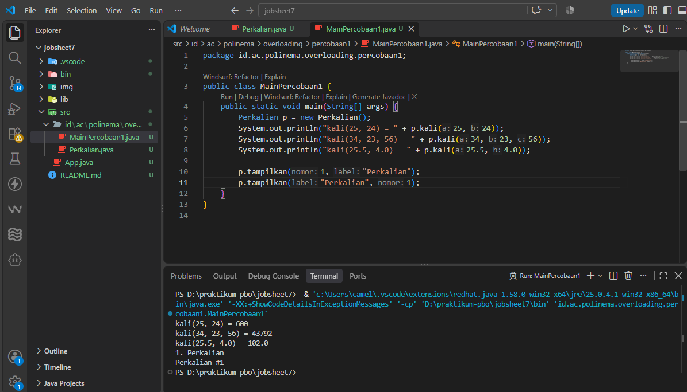
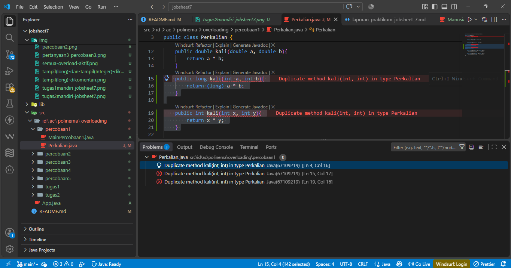

### 3. Source Code (`id.ac.polinema.overloading.percobaan1`)
**Perkalian.java**
```java
[package id.ac.polinema.overloading.percobaan1;

public class Perkalian {
    public int kali(int a, int b){
        return a * b;
    }

    public int kali(int a, int b, int c){
        return a * b * c;
    }

    public double kali(double a, double b){
        return a * b;
    } 

    public void tampilkan(int nomor, String label){
        System.out.println(nomor + ". " + label);
    }

    public void tampilkan(String label, int nomor){
        System.out.println(label + " #" + nomor);
    }
}
]
```

**MainPercobaan1.java**
```java
[package id.ac.polinema.overloading.percobaan1;

public class MainPercobaan1 {
    public static void main(String[] args) {
        Perkalian p = new Perkalian();
        System.out.println("kali(25, 43) = " + p.kali(25, 43));
        System.out.println("kali(34, 23, 56) = " + p.kali(34, 23, 56));
        System.out.println("kali(25.5, 4.0) = " + p.kali(25.5, 4.0));
        System.out.println("kali(5, 2.5) " + p.kali(5, 2.5));
        System.out.println("kali(2, 3) = " + p.kali(2, 3));
        System.out.println("kali(2.0, 3) = " + p.kali(2.0, 3));
        System.out.println("====================================");

        p.tampilkan(1, "Perkalian");
        p.tampilkan("Perkalian", 1);
    }
}
]
```

---

## B. Percobaan 2: Pemilihan Overload oleh Compiler (Resolusi)

### 1. Tabel Pengamatan Prediksi & Eksperimen
| Pemanggilan | Prediksi Anda | Hasil Sebenarnya |
|---|---|---|
| `tampil(5)` | tampil(long): 5 | tampil(long): 5 |
| `tampil(5L)` | tampil(long): 5 | tampil(long): 5 |
| `tampil(Integer.valueOf(7))` | tampil(Integer): 7 | tampil(Integer): 7 |
| `tampil(3.5)` | tampil(Object): 3.5 | tampil(Object): 3.5 |
| `tampil("Java")` | tampil(Object): Java | tampil(Object): Java |
| `tampil()` | tampil(int...): 0 elemen | tampil(int...): 0 elemen |
| `tampil(1, 2, 3)` | tampil(int...): 3 elemen | tampil(int...): 3 elemen |

**Tabel Eksperimen Kumulatif:**
| Kondisi | Overload yang dipanggil oleh tampil(5) |
|---|---|
| Semua overload aktif | tampil(long): 5 |
| `tampil(long)` dikomentari | tampil(Integer): 5 |
| `tampil(long)` dan `tampil(Integer)` dikomentari | tampil(Object): 5 |
| `tampil(long)`, `tampil(Integer)`, `tampil(Object)` dikomentari | tampil(int...): 1 elemen |

### 2. Screenshot Output & Error (Eksperimen 2)
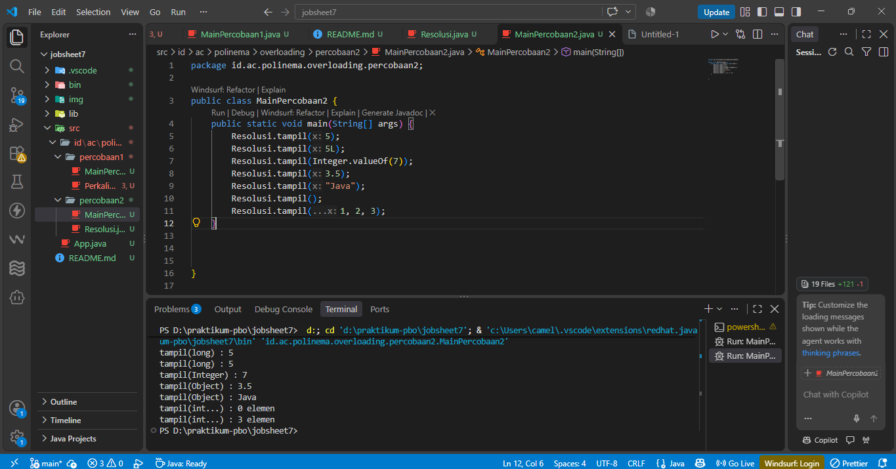
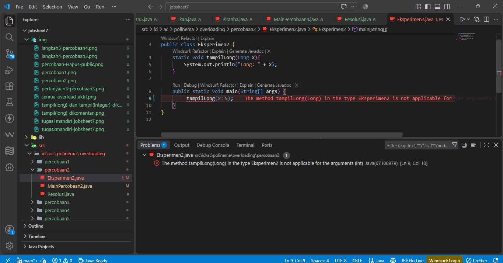

### 3. Source Code (`id.ac.polinema.overloading.percobaan2`)
**Resolusi.java**
```java
[package id.ac.polinema.overloading.percobaan2;

public class Resolusi {
    public static void tampil(long x){
        System.out.println("tampil(long) : " + x);
    }

    public static void tampil(Integer x){
        System.out.println("tampil(Integer) : " + x);
    }

    public static void tampil(Object x){
        System.out.println("tampil(Object) : " + x);
    }

    public static void tampil(int... x){
        System.out.println("tampil(int...) : " + x.length + " elemen");
    }

}
]
```

**MainPercobaan2.java**
```java
[package id.ac.polinema.overloading.percobaan2;

public class MainPercobaan2 {
    public static void main(String[] args) {
        Resolusi.tampil(5);
        Resolusi.tampil(5L);
        Resolusi.tampil(Integer.valueOf(7));
        Resolusi.tampil(3.5);
        Resolusi.tampil("Java");
        Resolusi.tampil();
        Resolusi.tampil(1, 2, 3);

        Resolusi.tampil((short) 3);
        Resolusi.tampil('A');
    }

    

}
]
```

**Eksperimen2.java**
```java
[package id.ac.polinema.overloading.percobaan2;

public class Eksperimen2 {
    static void tampilLong(Long x){
        System.out.println("Long: " + x);
    }

    public static void main(String[] args) {
        tampilLong(5);
    }
}
]
```

---

## C. Percobaan 3: Overloading Konstruktor (Kucing)

### 1. Screenshot Output & Error
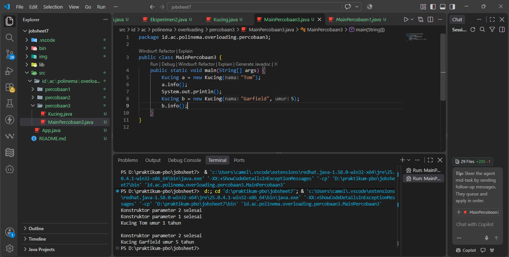
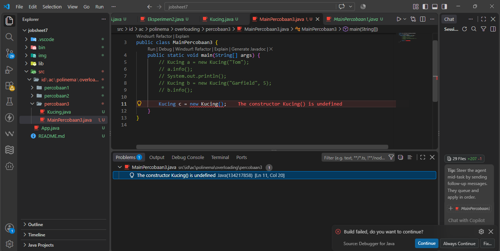

### 2. Source Code (`id.ac.polinema.overloading.percobaan3`)
**Kucing.java**
```java
[package id.ac.polinema.overloading.percobaan3;

public class Kucing {
    private String nama;
    private int umur;

    public Kucing(){
        this("Tanpa Nama");
        System.out.println("Konstruktor 0 parameter selesai");
    }

    public Kucing(String nama){
        this(nama, 1);
        System.out.println("Konstruktor parameter 1 selesai");
    }

    public Kucing(String nama, int umur){
        this.nama = nama;
        this.umur = umur;
        System.out.println("Konstruktor parameter 2 selesai");
    }

    public void info(){
        System.out.println("Kucing " +nama+ " umur " +umur+ " tahun" );
    }
}
]
```

**MainPercobaan3.java**
```java
[package id.ac.polinema.overloading.percobaan3;

public class MainPercobaan3 {
    public static void main(String[] args) {
        Kucing a = new Kucing("Tom");
        a.info();
        System.out.println();
        Kucing b = new Kucing("Garfield", 5);
        b.info();
        System.out.println();
        Kucing k = new Kucing();
        k.info();
    }
}
]
```

---

## D. Percobaan 4: Dasar Overriding (Ikan dan Piranha)

### 1. Tabel Eksperimen (Melanggar Aturan Overriding)
| Perubahan | Pesan error pertama |
|---|---|
| Hapus `public` pada `swim()` di Piranha | Cannot reduce the visibility of the inherited method from Ikan. |
| Tambahkan `final` pada `swim()` di Ikan | [Tulis/paste pesan error di sini] |
| Ubah `swim()` di Piranha menjadi `swim(int jarak)` | The method swim(int) of type Piranha must override or implement a supertype method |
| Tambahkan `throws Exception` pada `swim()` di Piranha | Exception Exception is not compatible with throws clause in Ikan.swim(). |

### 2. Screenshot Output & Error

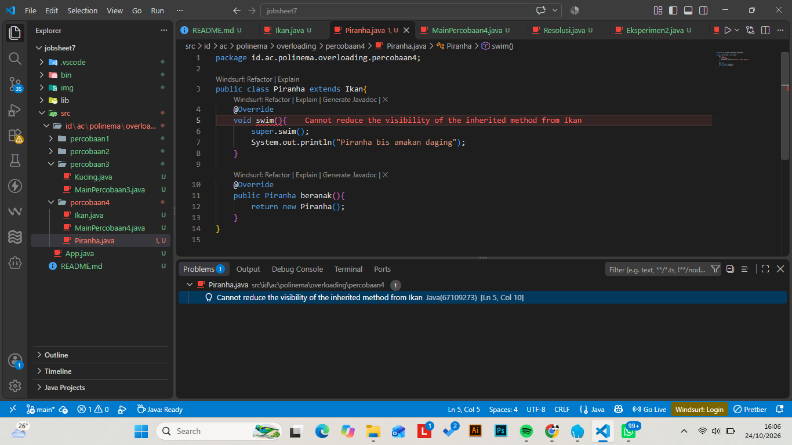
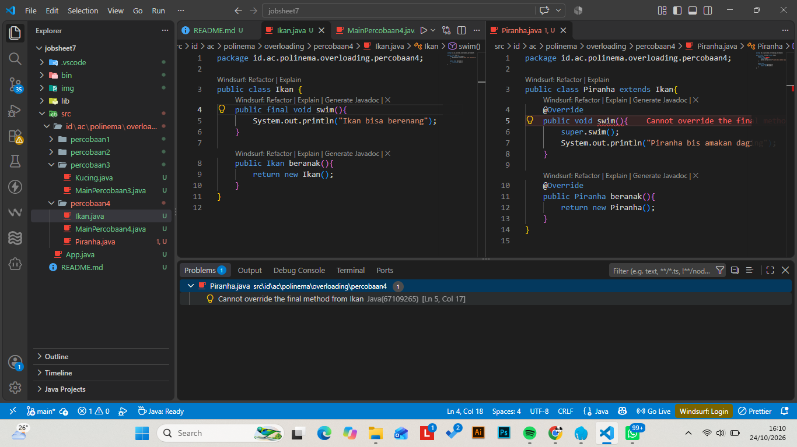
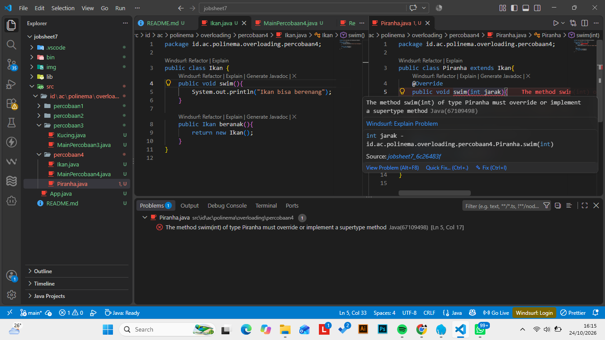

### 3. Source Code (`id.ac.polinema.overriding.percobaan4`)
**Ikan.java**
```java
[package id.ac.polinema.overloading.percobaan4;

public class Ikan {
    public void swim(){
        System.out.println("Ikan bisa berenang");
    }

    public Ikan beranak(){
        return new Ikan();
    }
}
]
```

**Piranha.java**
```java
[package id.ac.polinema.overloading.percobaan4;

public class Piranha extends Ikan{
    @Override 
    public void swim(){
        super.swim();
        System.out.println("Piranha bisa makan daging");
    }

    @Override
    public Piranha beranak(){
        return new Piranha();
    }
}
]
```

**MainPercobaan4.java**
```java
[package id.ac.polinema.overloading.percobaan4;

public class MainPercobaan4 {
    public static void main(String[] args) {
        Ikan a = new Ikan();
        Piranha c = new Piranha();

        a.swim();
        c.swim();

        Piranha anak = c.beranak();
        System.out.println("Tipe objek anak: " +anak.getClass().getSimpleName());
    }
}
]
```

---

## E. Percobaan 5: Overloading dan Overriding Bersama

### 1. Screenshot Output
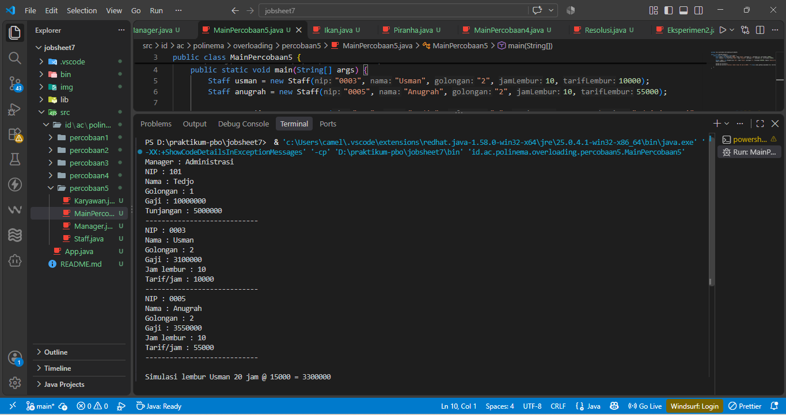

### 2. Source Code (`id.ac.polinema.overriding.percobaan5`)
**Karyawan.java**
```java
[package id.ac.polinema.overloading.percobaan5;

public class Karyawan {
    protected String nip;
    protected String nama;
    protected String golongan;
    protected double gajiPokok;

    public Karyawan(String nip, String nama, String golongan){
        this.nip = nip;
        this.nama = nama;
        this.golongan = golongan;
        this.gajiPokok = hitungGajiPokok(golongan);
    }

    private static double hitungGajiPokok(String golongan){
        return switch (golongan){
            case "1" -> 5000000;
            case "2" -> 3000000;
            case "3" -> 2000000;
            case "4" -> 1000000;
            case "5" -> 750000;
            default -> throw new IllegalArgumentException(
                "Golongan tidak dikenali: " + golongan
            );
        };
    }
      public String getNama(){
        return nama;
      }

      public double getGaji(){
        return gajiPokok;
      }

      public void lihatInfo(){
        System.out.println("NIP : " + nip);
        System.out.println("Nama : " + nama);
        System.out.println("Golongan : " + golongan);
        System.out.printf("Gaji : %.0f%n", getGaji());
      }
    }

]
```

**Staff.java**
```java
[package id.ac.polinema.overloading.percobaan5;

public class Karyawan {
    protected String nip;
    protected String nama;
    protected String golongan;
    protected double gajiPokok;

    public Karyawan(String nip, String nama, String golongan){
        this.nip = nip;
        this.nama = nama;
        this.golongan = golongan;
        this.gajiPokok = hitungGajiPokok(golongan);
    }

    private static double hitungGajiPokok(String golongan){
        return switch (golongan){
            case "1" -> 5000000;
            case "2" -> 3000000;
            case "3" -> 2000000;
            case "4" -> 1000000;
            case "5" -> 750000;
            default -> throw new IllegalArgumentException(
                "Golongan tidak dikenali: " + golongan
            );
        };
    }
      public String getNama(){
        return nama;
      }

      public double getGaji(){
        return gajiPokok;
      }

      public void lihatInfo(){
        System.out.println("NIP : " + nip);
        System.out.println("Nama : " + nama);
        System.out.println("Golongan : " + golongan);
        System.out.printf("Gaji : %.0f%n", getGaji());
      }
    }

]
```

**Manager.java**
```java
[package id.ac.polinema.overloading.percobaan5;

public class Manager extends Karyawan{
    private double tunjangan;
    private String bagian;
    private Staff[] bawahan;

    public Manager(String nip, String nama, String golongan, double tunjangan, String bagian, Staff[] bawahan) {
    super(nip, nama, golongan);
    this.tunjangan = tunjangan;
    this.bagian = bagian;
    this.bawahan = bawahan;
    }

    @Override
    public double getGaji() {
        return super.getGaji() + tunjangan;
    }

    public void viewStaff() {
        System.out.println("----------------------------");
        for (Staff s : bawahan) {
            s.lihatInfo();
            System.out.println("----------------------------");
        } 
    }

    @Override
    public void lihatInfo() {
    System.out.println("Manager : " + bagian);
    super.lihatInfo();
    System.out.printf("Tunjangan : %.0f%n", tunjangan);
    viewStaff();
    }
}
]
```

**MainPercobaan5.java**
```java
[package id.ac.polinema.overloading.percobaan5;

public class MainPercobaan5 {
    public static void main(String[] args) {
        Staff usman = new Staff("0003", "Usman", "2", 10, 10000);
        Staff anugrah = new Staff("0005", "Anugrah", "2", 10, 55000);

        Manager tedjo = new Manager("101", "Tedjo", "1", 5000000, "Administrasi", new Staff[] {usman, anugrah});
        tedjo.lihatInfo();

        System.out.println();
        System.out.println("Simulasi lembur Usman 20 jam @ 15000 = "+ (long) usman.getGaji(20, 15000));

    }
}
]
```

---

## F. Tugas Mandiri

### Tugas 1: Overloading pada class Segitiga
**Screenshot Output:**
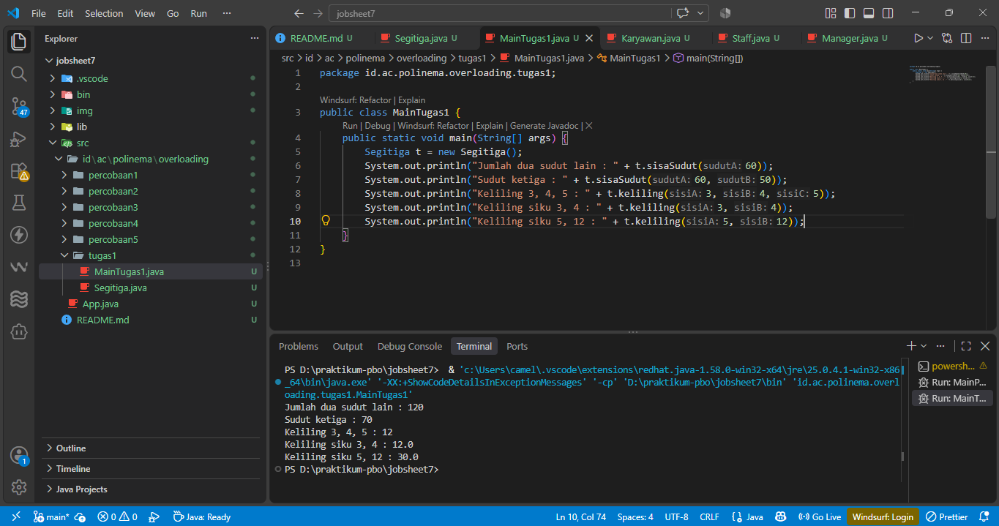

**Source Code (`id.ac.polinema.overloading.tugas1`):**
```java
package id.ac.polinema.overloading.tugas1;

public class Segitiga {
    private int sudut;

    public int sisaSudut(int sudutA) {
        if (sudutA <= 0 || sudutA >= 180) {
            throw new IllegalArgumentException("Jumlah sudut harus antara 1-179");
        }
        this.sudut = 180 - sudutA;
        return this.sudut;
    }
    
    public int sisaSudut(int sudutA, int sudutB) {
        if ((sudutA + sudutB) <= 0 || (sudutA + sudutB) >= 180) {
            throw new IllegalArgumentException("Jumlah sudut harus antara 1-179");
        }
        this.sudut = 180 - (sudutA + sudutB);
        return this.sudut;
    }

    public int keliling(int sisiA, int sisiB, int sisiC) {
        return sisiA + sisiB + sisiC;
    }

    public double keliling(int sisiA, int sisiB) {
        double c = Math.sqrt(Math.pow(sisiA, 2) + Math.pow(sisiB, 2));
        return sisiA + sisiB + c;
    }

    public int getSudut() {
        return sudut;
    }
}

```

### Tugas 2: Overriding pada Manusia, Dosen, dan Mahasiswa
**Screenshot Output:**
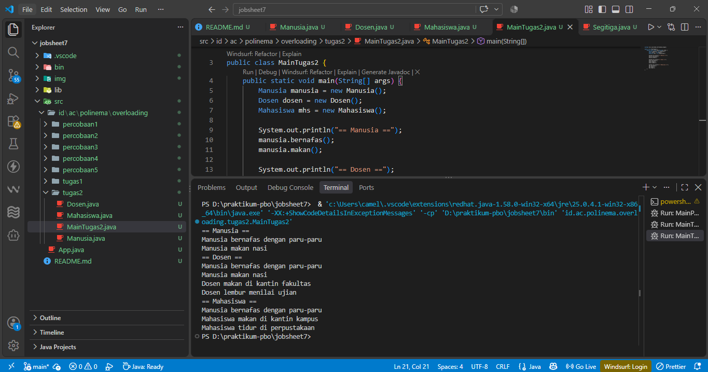

**Source Code (`id.ac.polinema.overriding.tugas2`):**
```java
package id.ac.polinema.overloading.tugas2;

public class Manusia {
    public void bernafas() {
        System.out.println("Manusia bernafas dengan paru-paru");
    }
    public void makan() {
        System.out.println("Manusia makan nasi");
    }
}

package id.ac.polinema.overloading.tugas2;

public class Dosen extends Manusia{
    @Override
    public void makan() {
        super.makan();
        System.out.println("Dosen makan di kantin fakultas");
    }
    public void lembur() {
        System.out.println("Dosen lembur menilai ujian");
    }
}

package id.ac.polinema.overloading.tugas2;

public class Mahasiswa extends Manusia {
    @Override
    public void makan() {
        System.out.println("Mahasiswa makan di kantin kampus");
    }
    public void tidur() {
        System.out.println("Mahasiswa tidur di perpustakaan");
    }
}

package id.ac.polinema.overloading.tugas2;

public class MainTugas2 {
    public static void main(String[] args) {
        Manusia manusia = new Manusia();
        Dosen dosen = new Dosen();
        Mahasiswa mhs = new Mahasiswa();

        System.out.println("== Manusia ==");
        manusia.bernafas();
        manusia.makan();

        System.out.println("== Dosen ==");
        dosen.bernafas();
        dosen.makan();
        dosen.lembur();

        System.out.println("== Mahasiswa ==");
        mhs.bernafas();
        mhs.makan();
        mhs.tidur();
    }
}

```


## Pertanyaan Percobaan 1
1. Sebutkan method hasil overloading pada Perkalian dan pembeda tiap pasangannya (jumlah,
tipe, atau urutan parameter).
**Jawab:**
**Method kali mengalami overloading dengan perbedaan pada jumlah parameter (2 parameter int, 3 parameter int) serta tipe parameter (2 parameter double). Method tampilkan juga di overload dengan perbedaan urutan tipe parameter (int dan String berbanding String dan int)**

2. Pada p.kali(25.5, 4.0), versi kali() mana yang dipanggil? Mengapa bukan versi int?
**Jawab:**
**kali(double a, double b) yang dipanggil karena compiler mencocokkan nilai argumen bilangan desimal (double) pada pemanggilan tersebut dengan parameter tipe double secara spesifik.**

3. Mengapa tampilkan(int, String) dan tampilkan(String, int) sah sebagai
overloading, sedangkan dua method yang hanya beda tipe kembalian atau nama parameter
tidak?
**Jawab:**
**Karena Overloading bergantung secara mutlak pada perbedaan signature yang terdiri dari jumlah, tipe, atau urutan parameter. Perbedaan pada nama variabel atau tipe data kembalian (return type) tidak berlaku sebagai pembeda bagi compiler**

4. Pada eksperimen ketiga, mengapa kali(5, 2.5) menghasilkan 12.5 dan bukan error?
**Jawab:**
**Compiler Java melakukan proses penyesuaian tipe otomatis (widening), di mana angka 5 yang bertipe dasar int diperlebar kapasitasnya ke double sehingga cocok mengisi argumen kali(double, double)**

## Pertanyaan Percobaan 2
**Checkpoint output berturut-turut**
1. Mengapa tampil(5) memilih tampil(long) dan bukan tampil(Integer), padahal 5 dapat
di-boxing? Sebutkan fase yang menentukan.
**Jawab:**
**Pemilihan tampil(5): Fase penentu adalah fase pertama (widening). Compiler menemukan kecocokan int ke long pada fase ini, sehingga tidak perlu turun ke fase kedua (boxing ke Integer).**

2. Jelaskan perpindahan overload pada tiap baris tabel Langkah 3.
**Jawab:**
**Perpindahan overload (Langkah 3): Compiler bergerak dari widening (long), turun ke boxing (Integer), lalu boxing diikuti widening (Object), dan terakhir beralih ke argumen jamak/ varargs (int...).**

3. Mengapa tampilLong(5) gagal, sedangkan tampil(5) dapat berakhir pada tampil(Object)
bila overload lain dikomentari?
**Jawab:**
**Alasan tampilLong(5) gagal karena Java melarang pelebaran bertahap langsung ganda (widening int ke long, lalu boxing ke Long). Sebaliknya, tampil(Object) berhasil karena urutannya boleh (boxing int ke Integer, lalu widening ke Object).**

4. Tantangan. Tanpa menjalankan, prediksi output Resolusi.tampil((short) 3) dan
Resolusi.tampil('A'), lalu buktikan.

## Pertanyaan Percobaan 3
Pertanyaan Percobaan 3
1. Mengapa Konstruktor 2 parameter selesai tercetak lebih dulu daripada Konstruktor 1
parameter selesai pada new Kucing("Tom")?
**Jawab**
**Karena `new Kucing("Tom")` memanggil konstruktor 1 parameter terlebih dahulu, pada baris pertamanya mengeksekusi `this(nama, 1)` untuk lompat ke konstuktor 2 parameter. Jadi konstruktor dua parameter selesai lebih dulu.**

2. Apa keuntungan this(nama, 1) dibandingkan menyalin isi konstruktor kedua ke
konstruktor pertama?
**Jawab**
**Mencegah duplikat penulisan kode atau logika yang sama secara berulang pada konstruktor yang berbeda.**

3. Tambahkan public Kucing() yang memanggil this("Tanpa Nama") dan mencetak
Konstruktor 0 parameter selesai. Tuliskan output new Kucing() serta urutan ketiga
konstruktor dijalankan.
**Jawab**
**Output dari** `new Kucing()`
**Konstruktor parameter 2 selesai**
**Konstruktor parameter 1 selesai**
**Konstruktor 0 parameter selesai**

## Pertanyaan Percobaan 4
Cannot reduce the visibility of the inherited method from Ikan
Cannot override the final method from Ikan
The method swim(int) of type Piranha must override or implement a supertype method
Exception Exception is not compatible with throws clause in Ikan.swim().

1. Bandingkan a.swim() dan c.swim(). Apa peran super.swim(), dan apa yang tercetak bila
baris itu dihapus?
**Jawab**
Pemanggilan a.swim() mengeksekusi method dari class induk dan hanya mencetak "Ikan bisa berenang". Pemanggilan c.swim() mengeksekusi method override di class Piranha yang mencetak "Ikan bisa berenang" disusul "Piranha bisa makan daging". Peran super.swim(): Berfungsi memanggil perintah swim() milik superclass (Ikan) ke dalam method subclass. Jika baris tersebut dihapus, pemanggilan c.swim() hanya akan mencetak "Piranha bisa makan daging".

2. Apa manfaat covariant return pada beranak()? Apakah Piranha anak = a.beranak();
valid? Mengapa?
**Jawab**
Memungkinkan class turunan mengembalikan tipe data yang lebih spesifik (objek Piranha) dibandingkan tipe data asli induknya, sehingga pemrogram tidak perlu repot melakukan type casting (konversi tipe data manual) saat menampung hasil method tersebut. Apakah Piranha anak = a.beranak(); valid?: Tidak valid. Variabel a bertipe Ikan, sehingga a.beranak() pasti mengembalikan objek induk Ikan. Objek tipe induk tidak bisa dimasukkan secara langsung ke dalam wadah variabel bertipe anak (Piranha).

3. Untuk tiap baris tabel Langkah 4, sebutkan aturan overriding yang dilanggar.
**Jawab**
Baris 1: Melanggar aturan hak akses (access modifier pada subclass tidak boleh lebih sempit/ketat daripada superclass).

Baris 2: Melanggar aturan atribut konstan (method induk yang ditandai final mutlak tidak bisa di-override).

Baris 3: Melanggar aturan signature (daftar dan tipe parameter harus sama persis dengan induk).

Baris 4: Melanggar aturan eksepsi (method override dilarang melempar checked exception baru yang tidak dideklarasikan induknya).

4. Pada baris ketiga tabel, apa yang terjadi bila @Override dihapus? Apakah swim(int)
overriding atau overloading?
**Jawab**
Pesan error kompilasi akan hilang dan program berjalan normal. Status method swim(int) di Piranha tersebut berubah menjadi method overloading karena memiliki nama yang sama dengan method induk namun memiliki parameter yang berbeda.

5. Tantangan. Jika swim() di Ikan dibuat private dan Piranha memiliki @Override public
void swim(), apa yang terjadi? Mengapa?
**Jawab**
Akan muncul pesan error saat kompilasi pada anotasi @Override di class Piranha. Alasannya, modifier private membuat method tersebut tersembunyi dan tidak pernah diwariskan ke subclass. Karena method induk tidak diwariskan, compiler menganggap tidak ada method yang bisa di-override oleh Piranha.

## Pertanyaan Percobaan 5
1. Tunjuk method yang termasuk overloading dan yang termasuk overriding pada ketiga class
(sebutkan class dan signature-nya), dan jelaskan pembeda masing-masing.
**Overriding (Penimpaan Method Induk)**
Class Manager: getGaji() dan lihatInfo()
Class Staff: getGaji() dan lihatInfo()
Method-method di atas menimpa (meng-override) method bawaan dengan nama dan parameter yang sama persis dari class induk Karyawan.

**Overloading (Kelebihan Beban Method)**
Class Staff: getGaji(int jamLembur, double tarifLembur)
Method ini bertindak sebagai overloading terhadap method getGaji() tanpa parameter yang juga ada di dalam class Staff.

**Overriding:** Syarat mutlaknya adalah nama method dan parameternya harus sama persis dengan method di class induknya. Proses ini terjadi lintas class yang memiliki relasi pewarisan, dan bertujuan untuk mengganti atau memodifikasi cara kerja bawaan dari induk (misalnya, menambahkan perhitungan tunjangan pada manajer).

**Overloading:** Nama method sama, tetapi daftar parameternya harus berbeda (baik dari segi jumlah maupun tipe data). Proses ini terjadi di dalam satu konteks class yang sama, bertujuan untuk memberikan variasi pilihan input (misalnya, menghitung gaji reguler vs menghitung simulasi gaji dengan jam lembur kustom).

2. Mengapa getGaji(int, double) memakai super.getGaji(), sedangkan getGaji() pada
Staff memanggil getGaji(jamLembur, tarifLembur)? Apa yang terjadi bila isi
getGaji(int, double) diganti return getGaji() + jamLembur * tarifLembur;?

3. Apa akibatnya pada gaji Staff bila getGaji() di Staff ditulis return jamLembur *
tarifLembur;? Apakah gaji Manager ikut berubah?
Method getGaji(int, double) menggunakan super.getGaji() untuk secara spesifik mengambil nilai gaji pokok dasar dari class induk (Karyawan). Di sisi lain, method getGaji() tanpa parameter pada Staff sengaja memanggil getGaji(jamLembur, tarifLembur) untuk mendaur ulang rumus perhitungan total gaji yang sudah ada. Cara ini mencegah penulisan kode berulang (code duplication), di mana ia cukup menyuntikkan data atribut bawaan milik staf tersebut ke dalam rumus overloading.

Jika kata kunci super dihapus, program akan mengalami error perulangan tanpa henti (infinite recursion) yang berujung pada kerusakan memori StackOverflowError saat dijalankan.

Hal ini terjadi karena penghapusan super membuat perintah getGaji() mencari method di dalam class Staff itu sendiri. Akibatnya, getGaji(int, double) akan memanggil getGaji(), dan getGaji() akan kembali memanggil getGaji(int, double). Kedua method ini akan terus saling memanggil satu sama lain dalam siklus tertutup tanpa titik henti.

4. Apa hubungan Manager dengan Staff (is-a atau has-a)? Tunjuk atributnya dan bandingkan
dengan hubungan Manager dengan Karyawan.
Hubungan antara Manager dan Staff adalah has-a (agregasi). Relasi ini secara nyata dibuktikan dengan keberadaan atribut bawahan bertipe array Staff[] di dalam class Manager, yang berfungsi untuk menyimpan daftar objek staf yang dipimpin oleh manajer tersebut.

Sebagai perbandingan, hubungan antara Manager dan Karyawan adalah is-a (pewarisan). Secara hierarki konseptual, seorang manajer pada dasarnya adalah seorang karyawan. Hal ini dibuktikan melalui deklarasi class Manager yang bertindak sebagai subclass turunan langsung dari superclass Karyawan (biasanya menggunakan kata kunci extends), sehingga secara otomatis mewarisi atribut dasar seperti nama, NIP, dan gaji pokok.

## Tugas dan Deliverable
Checkpoint tugas mandiri 1


Pertanyaan analisis: 
(a) keliling(3, 4, 5) dan keliling(3, 4) bertipe kembalian berbeda.
Apakah itu yang membuatnya sah sebagai overloading? Apa pembeda sebenarnya?
Bukan, tipe kembalian (return type) tidak membedakan method overloading secara sah. Pembeda sebenarnya pada keliling(3, 4, 5) dan keliling(3, 4) adalah jumlah parameternya yang berbeda (tiga parameter int berbanding dua parameter int).

(b) Apa yang terjadi bila t.keliling(3, 4.0) dipanggil? Tuliskan pesan error dan alasannya.
no suitable method found for keliling(int, double). Hal ini terjadi karena angka 4.0 bertipe double, sedangkan tidak ada method keliling yang menerima parameter (int, double). Tipe double tidak dapat dipersempit (narrowing) secara otomatis menjadi int untuk masuk ke keliling(int, int).

Checkpoint tugas mandiri 2


Pertanyaan analisis: 
(a) Mengapa bernafas() pada objek Mahasiswa mencetak teks milik Manusia, sedangkan makan() tidak?
Method bernafas() pada objek Mahasiswa mencetak teks milik Manusia karena method tersebut murni diwarisi dari class induk tanpa di-override. Sebaliknya, method makan() tidak mencetak teks induk karena sudah di-override (ditulis ulang) oleh class Mahasiswa dengan implementasinya sendiri.

(b) Bandingkan hasil makan() pada Dosen dan Mahasiswa, lalu jelaskan peran super.makan().
Hasil makan() pada Dosen mencetak teks milik induk ("makan nasi") lalu diikuti teks miliknya sendiri ("kantin fakultas"). Ini karena perintah super.makan() sengaja memanggil dan mengeksekusi method asli milik superclass sebelum menjalankan kode tambahannya. Pada Mahasiswa, tidak ada super.makan(), sehingga perilaku induk dibuang sepenuhnya dan hanya digantikan oleh teks "kantin kampus".

## Tugas 3: Jawab Singkat
**1. Tabel Perbandingan:**
| Aspek | Overloading | Overriding |
|---|---|---|
| Lokasi terjadi | Dalam satu *class* yang sama | Di dalam *subclass* (kelas anak) |
| Signature (parameter) | Harus berbeda (jumlah/tipe/urutan) | Harus sama persis dengan induk |
| Tipe kembalian | Bebas berbeda | Sama atau *covariant return* |
| Access modifier | Bebas | Sama atau lebih luas dari induk |
| Peran @Override | Menghasilkan *error* jika digunakan | Dianjurkan sebagai validasi *compiler* |

**2. Kapan Memilih Overloading vs Overriding:**
Pilih Overloading ketika Anda butuh kemudahan memanggil aksi logis yang sama tetapi dengan variasi masukan data yang berbeda. 
Contoh: method sisaSudut() yang bisa menerima 1 sudut atau 2 sudut sekaligus.   

Pilih Overriding ketika Anda ingin memodifikasi atau menspesifikkan perilaku warisan dari induk ke anak. 
Contoh: Induk Ikan berenang biasa, tapi anak Piranha meng-override method renangnya agar berenang sambil memakan daging.
 
**3. Alasan Method Tertentu Tidak Dapat Di-override:**
Static: Terikat pada level class secara global, bukan pada instance objek, sehingga tidak bisa ditimpa melalui polimorfisme objek.
Private: Method ini tersembunyi dan tidak pernah diwariskan ke subclass, sehingga subclass tidak memiliki akses untuk menimpanya.
Final: Kata kunci ini secara eksplisit mengunci method agar permanen dan secara sepihak melarang subclass untuk mengubah isinya.