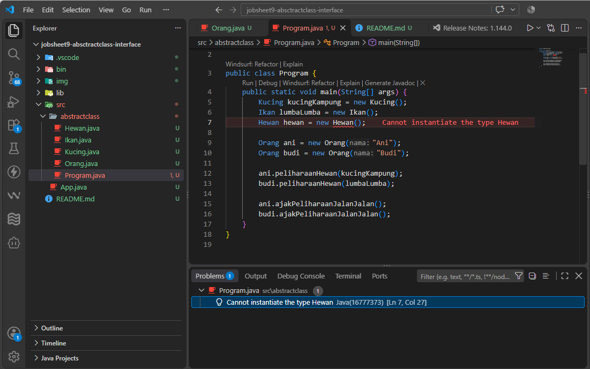
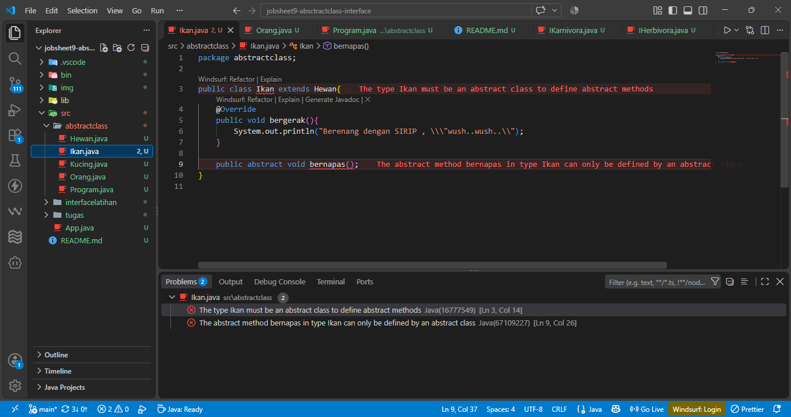
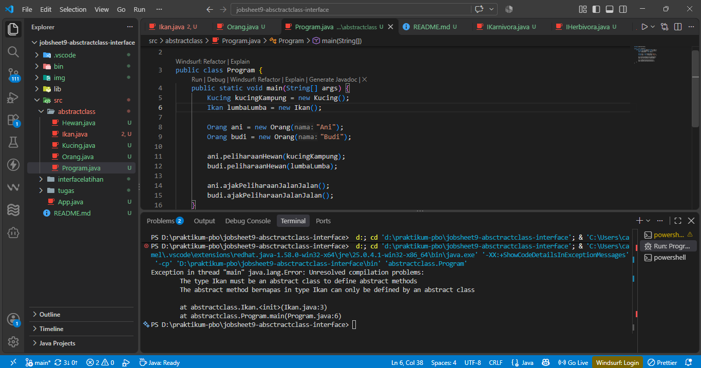

| Nama | Camelia Azzahra |
|---|---|
| NIM | 264107023014 |
| Kelas | Teknik Informatika - 2G |

---

# Laporan Praktikum PBO - Jobsheet 9: Abstract Class dan Interface

## Percobaan 1: Abstract Class


## Pertanyaan Percobaan 1
1. Jelaskan jalannya program di atas. Mengapa pemanggilan this hewanPeliharaan.bergerak() di class Orang menghasilkan output yang berbeda untuk Ani dan Budi?
Program berjalan dengan menerapkan konsep Polimorfisme *(Dynamic Method Dispatch)*. Pada saat instansiasi, ani memelihara objek kucingKampung (tipe Kucing) dan budi memelihara objek lumbaLumba (tipe Ikan). Saat method `ajakPeliharaanJalanJalan()` memanggil `this.hewanPeliharaan.bergerak()`, JVM mengeksekusi method `bergerak()` milik class turunan yang sesuai dengan objek aslinya (Kucing atau Ikan), bukan milik class abstrak Hewan.

2. Tambahkan baris `Hewan hewan = new Hewan()`; pada method `main()`. Tunjukkan hasil kompilasinya dan jelaskan secara singkat.
Akan terjadi error saat kompilasi (Hewan is abstract; cannot be instantiated). Alasannya adalah abstract class tidak bisa dibuat objeknya diinstansiasi secara langsung karena dianggap sebagai cetak biru yang belum sempurna (masih ada abstract method yang belum memiliki bodi).


3. Bolehkah sebuah class yang meng-extend abstract class tidak mengimplementasikan abstract method induknya? Buktikan dengan menghapus method bergerak() dari class Ikan, lalu tunjukkan hasil kompilasinya dan jelaskan.
**Tidak boleh.** Apabila class `Ikan` tidak meng override method `bergerak()`, akan terjadi error kompilasi `(Ikan is not abstract and does not override abstract method bergerak() in Hewan)`. Sebuah class turunan wajib mengimplementasikan seluruh abstract method dari induknya, kecuali jika class turunan tersebut juga dideklarasikan sebagai abstract class.

4. Tambahkan abstract method public abstract void bernapas(); di dalam class Ikan
tanpa mengubah deklarasi class Ikan. Tunjukkan hasil kompilasinya dan jelaskan aturan yang dilanggar.



Ketika menambahkan `public abstract void bernapas();` ke dalam class `Ikan` yang merupakan class biasa (bukan abstract), akan muncul error kompilasi dengan pesan:
*The type Ikan must be an abstract class to define abstract methods*.

Aturan yang dilanggar:
Di dalam Java, ada aturan baku bahwa setiap class yang memiliki minimal satu *abstract method* **wajib dideklarasikan sebagai abstract class**. Karena method `bernapas()` dideklarasikan menggunakan kata kunci abstract yang berarti method ini tidak memiliki badan/isi, maka class Ikan tempat bernaungnya method tersebut tidak boleh lagi berupa class non-abstract, melainkan harus diubah deklarasinya menjadi `public abstract class Ikan`.

---

## Percobaan 2: Interface

## Pertanyaan Percobaan 2
1. Mengapa pada langkah 7 terjadi error? Tuliskan pesan error-nya dan jelaskan bagaimana Anda memperbaikinya.
Error terjadi karena objek `mhsBiasa` dideklarasikan dari class Mahasiswa yang tidak mengimplementasikan interface `ICumlaude`. Sementara itu, parameter pada method `beriSertifikatCumlaude()` secara spesifik meminta objek dengan tipe `ICumlaude`.
Pesan error-nya adalah *The method beriSertifikatCumlaude(ICumlaude) in the type Rektor is not applicable for the arguments (Mahasiswa).*
Cara memperbaikinya adalah dengan menghapus atau mengomentari kode pemanggilan objek tersebut `(// pakRektor.beriSertifikatCumlaude(mhsBiasa);)`.


2. Dapatkah method kuliahDiKampus() dipanggil dari objek sarjanaCumlaude di class Program? Mengapa demikian?
Bisa dilakukan. Objek `sarjanaCumlaude` merupakan instansiasi dari class Sarjana yang mewarisi *(extends)* class `Mahasiswa`. Sesuai konsep pewarisan *(inheritance)*, semua method induk seperti `kuliahDiKampus()` akan diwariskan ke class turunannya dan dapat langsung dipanggil oleh objek turunan tersebut.

3. Dapatkah method `kuliahDiKampus()` dipanggil dari parameter `mahasiswaCumlaude` di method `beriSertifikatCumlaude()` pada class `Rektor`? Mengapa demikian?
Tidak bisa. Parameter `mahasiswaCumlaude` dideskripsikan bertipe interface `ICumlaude`. Saat sebuah objek di casting atau dipanggil melalui *tipe interface*, kompilator Java hanya mengenali method yang dideklarasikan di dalam *interface* itu saja yaitu `lulus()` dan `meraihIPKTinggi()`, terlepas dari apakah objek aslinya `Sarjana` atau `PascaSarjana` memiliki method lain.

4. Hapus kata kunci public pada method lulus() di class Sarjana. Tunjukkan hasil kompilasinya dan jelaskan, lalu kembalikan seperti semula
Muncul error kompilasi dengan pesan `"Cannot reduce the visibility of the inherited method from ICumlaude."` Aturan pada Java menetapkan bahwa semua method bawaan interface otomatis bersifat public dan abstract. Saat class Sarjana mengimplementasikan method tersebut, hak aksesnya *modifier visibility* tidak boleh diturunkan menjadi default tanpa penulisan modifier atau private, implementasi method interface harus dideklarasikan sebagai public.


---

## Percobaan 3: Multiple Interface
## Pertanyaan Percobaan 3
1. Pada interface IBerprestasi, ganti modifier public pada method `menjuaraiKompetisi()` menjadi *protected* dan pada method `membuatPublikasiIlmiah()` menjadi *private*. Apa yang terjadi? Jelaskan alasannya
(sertakan capture hasilnya), lalu kembalikan seperti semula.
Terjadi error kompilasi. Di dalam bahasa Java, aturan dasarnya menetapkan bahwa semua abstract method di dalam sebuah interface secara otomatis bersifat public dan *abstract*. Oleh karena itu, tidak diperbolehkan memberikan modifier *protected* pada *abstract* method di dalam *interface*. Penggunaan modifier *private* pada *interface* karena mulai Java versi 9 hanya diizinkan jika method tersebut memiliki body implementasi, bukan untuk *abstract* method.


2. Tambahkan baris IBerprestasi prestasi = new IBerprestasi(); pada method
main(). Mengapa baris tersebut error?
Baris tersebut akan memunculkan error karena `IBerprestasi` adalah sebuah *interface*. *Interface* hanyalah sebuah kontrak atau rancangan abstrak, sehingga tidak dapat dibuat objeknya diinstansiasi secara langsung menggunakan kata kunci *new*. Objek hanya bisa dibuat dari class konkret yang mengimplementasikan *interface* tersebut.
3. Apabila Sarjana Berprestasi harus menjuarai kompetisi NASIONAL dan menerbitkan artikel di jurnal NASIONAL, modifikasilah class-class yang terkait agar di class Program objek pakRektor dapat memberikan sertifikat mawapres kepada objek sarjanaCumlaude, dengan output seperti berikut.
**Output yang diharapkan:**
```text
Saya REKTOR, memberikan sertifikat MAWAPRES.
Selamat! Bagaimana Anda bisa berprestasi?
Saya telah menjuarai kompetisi NASIONAL
Saya menerbitkan artikel di jurnal NASIONAL
----------------------------------------
Saya REKTOR, memberikan sertifikat MAWAPRES.
Selamat! Bagaimana Anda bisa berprestasi?
Saya telah menjuarai kompetisi INTERNASIONAL
Saya menerbitkan artikel di jurnal INTERNASIONAL
----------------------------------------
```
Agar objek sarjanaCumlaude bisa menerima sertifikat mawapres dengan tingkat NASIONAL dan memunculkan output yang sesuai, harus menambahkan implementasi interface IBerprestasi ke dalam class Sarjana.
Ubah deklarasi class Sarjana dengan menambahkan IBerprestasi setelah ICumlaude
**modifikasi class Sarjana.java**
```java
package interfacelatihan;

public class Sarjana extends Mahasiswa implements ICumlaude, IBerprestasi {
    public Sarjana(String nama) {
        super(nama);
    }

    @Override
    public void lulus() {
        System.out.println("Aku sudah menyelesaikan SKRIPSI");
    }

    @Override
    public void meraihIPKTinggi() {
        System.out.println("IPK-ku lebih tinggi dari 3,51");
    }

    @Override
    public void menjuaraiKompetisi() {
        System.out.println("Saya telah menjuarai kompetisi NASIONAL");
    }

    @Override
    public void membuatPublikasiIlmiah() {
        System.out.println("Saya menerbitkan artikel di jurnal NASIONAL");
    }
}

```


---

## TUGAS MANDIRI
**Petunjuk:** Binatang adalah abstract class (hubungan “adalah”), sedangkan IKarnivora dan
IHerbivora adalah interface (hubungan “dapat”). Class Gorilla meng-implements kedua interface
sekaligus. Karena kedua interface memiliki method displayMakan() dengan signature yang sama,
Gorilla cukup menuliskan satu method displayMakan().

1. Interface `IKarnivora` dan `IHerbivora`
Pembuatan dua interface yang berfungsi sebagai kontrak bagi hewan pemakan daging `IKarnivora` dan hewan pemakan tumbuhan `IHerbivora`. Keduanya mendefinisikan abstract method `displayMakan()`.


2. Abstract Class `Binatang`
Binatang dirancang sebagai abstract class (induk utama) yang menyimpan state umum seluruh binatang, yaitu `nama` dan `jmlKaki`. Class ini menyediakan constructor, getter-setter, serta method konkret displayBinatang().


3. Class `Keledai` (Implementasi IHerbivora)
Class `Keledai` mewarisi Binatang dan mengimplementasikan `IHerbivora`. Oleh karena itu, wajib meng override method `displayMakan()` khusus untuk herbivora. Method `displayData()` menggabungkan seluruh output atribut.


4. Class `Singa` (Implementasi IKarnivora)
Hampir sama dengan `Keledai`, namun class `Singa` mengimplementasikan `IKarnivora` sehingga pesan `displayMakan()` disesuaikan menjadi karnivora pemakan daging.


5. Class `Gorilla` (Multiple Interface)
Class Gorilla mendemonstrasikan Multiple Interface. Gorilla bertindak sebagai pemakan daging sekaligus tumbuhan (Omnivora), sehingga ia meng-implements IKarnivora dan IHerbivora sekaligus. Karena kedua interface tersebut memiliki method displayMakan() yang identik secara signature, Gorilla cukup mendefinisikan bodi method tersebut satu kali.


6. Class Utama `Program.java`
Ini merupakan main class untuk mengeksekusi program. Pada class ini, objek dari Keledai, Gorilla, dan Singa diinstansiasi dengan nilai argumen sesuai dengan kriteria yang diminta pada soal, lalu dicetak menggunakan displayData().


## Class Diagram UML


