## Laporan Praktikum PBO - Jobsheet 9: Polimorfisme

| Nama | Camelia Azzahra |
|---|---|
| NIM | 264107023014 |
| Kelas | Teknik Informatika - 2G |

---

## A. Percobaan 1: Bentuk Dasar Polimorfisme

### 1. Bagian Gambaran Konsep (GambaranDasar)

### Tabel Pengamatan Eksperimen Langkah 4
| Perubahan | Pesan Error |
|---|---|
| Aktifkan baris `Vegetarian v2 = l;` | Type mismatch: cannot convert from GambaranDasar.Lion to GambaranDasar.Vegetarian | 

### 2. Screenshot Output & Error

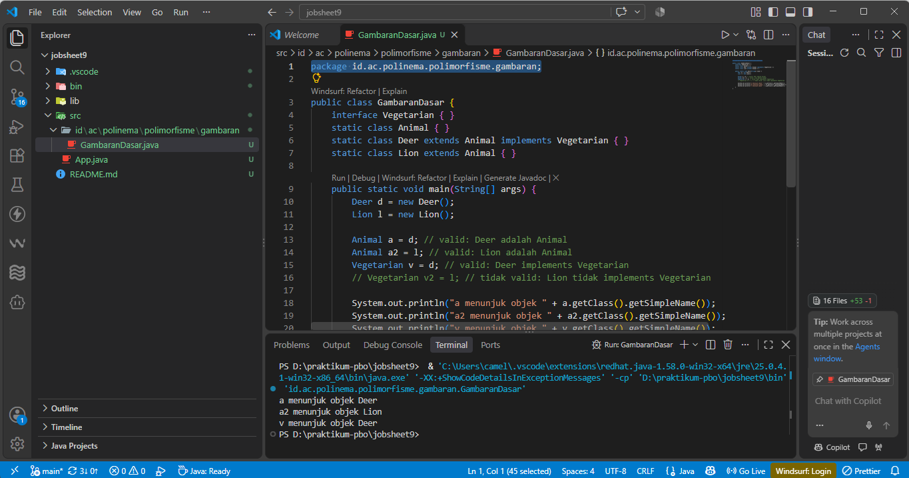
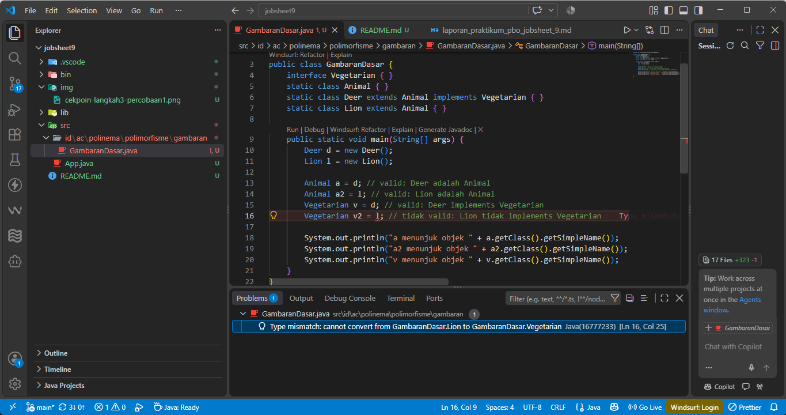

### 3. Tabel Pengamatan Eksperimen Langkah 10

| Tambahan pada main | Pesan Error |
|---|---|
| `p = iEmp;` | **incompatible types:** InternshipEmployee cannot be converted to Payable |
| `e = eBill;` | **incompatible types:** ElectricityBill cannot be converted to Employee |
| `Vegetarian v2 = l;` *(pada GambaranDasar)* | **incompatible types:** Lion cannot be converted to Vegetarian |

### 4. Screenshot Output Langkah 9 Percobaan 1

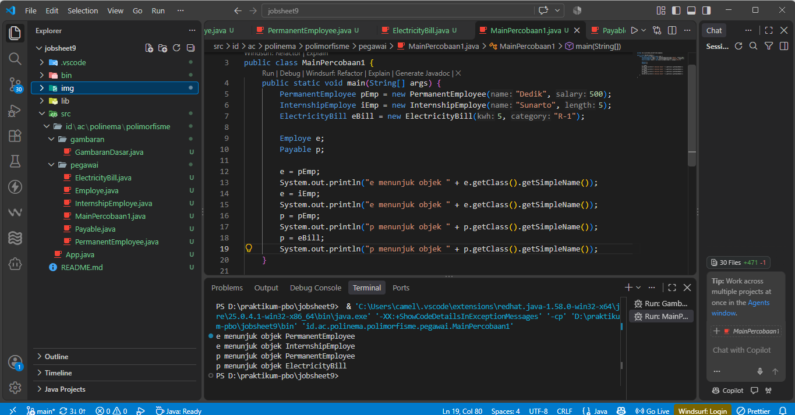

### 3. Source Code (`id.ac.polinema.polimorfisme.pegawai`)

**Employee.java**
```java
package id.ac.polinema.polimorfisme.pegawai;

public class Employee {
    protected String name;

    public Employee(String name) {
        this.name = name;
    }

    public String getEmployeeInfo() {
        return "Name = " + name;
    }
}
```

**Payable.java**
```java
package id.ac.polinema.polimorfisme.pegawai;

public interface Payable {
    int getPaymentAmount();
}
```

**Payable.java**
```java
package id.ac.polinema.polimorfisme.pegawai;

public interface Payable {
    int getPaymentAmount();
}
```

**MainPercobaan1.java**
```java
package id.ac.polinema.polimorfisme.pegawai;

public class MainPercobaan1 {
    public static void main(String[] args) {
        PermanentEmployee pEmp = new PermanentEmployee("Dedik", 500);
        InternshipEmployee iEmp = new InternshipEmployee("Sunarto", 5);
        ElectricityBill eBill = new ElectricityBill(5, "R-1");
        
        Employee e;
        Payable p;
        
        e = pEmp;
        System.out.println("e menunjuk objek " + e.getClass().getSimpleName());
        e = iEmp;
        System.out.println("e menunjuk objek " + e.getClass().getSimpleName());
        p = pEmp;
        System.out.println("p menunjuk objek " + p.getClass().getSimpleName());
        p = eBill;
        System.out.println("p menunjuk objek " + p.getClass().getSimpleName());
        
        // Eksperimen
        // p = iEmp;
        // e = eBill;
    }
}
```

---

## B. Percobaan 2: Virtual Method Invocation

### 1. Tabel Eksperimen
| Perubahan | Pesan Error |
|---|---|
| Panggil `e.getSalary()` pada `e` bertipe `Employee` | The method getSalary() is undefined for the type Employe |

### 2. Screenshot Output & Error
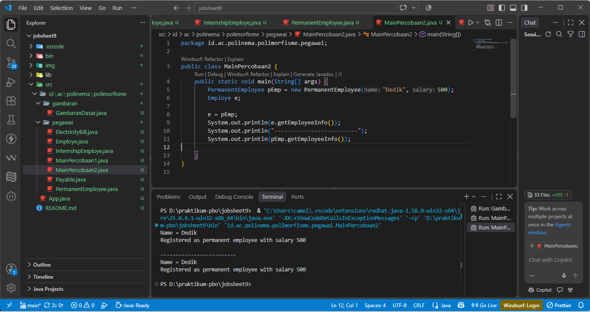
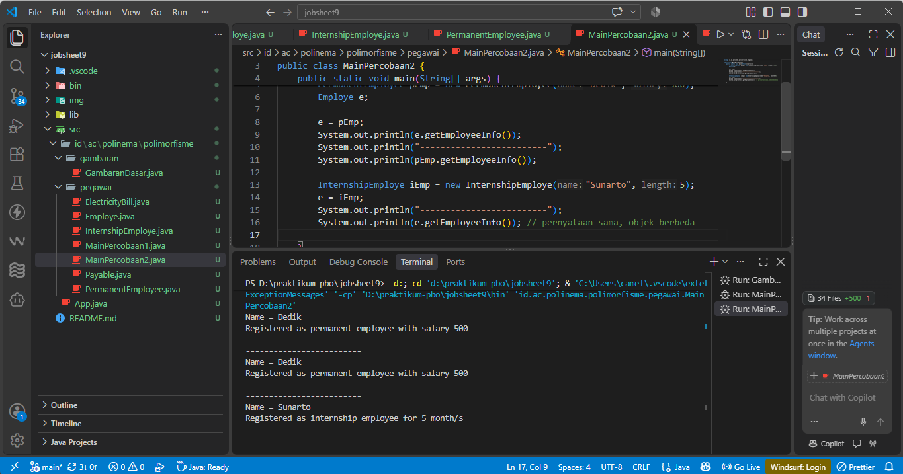
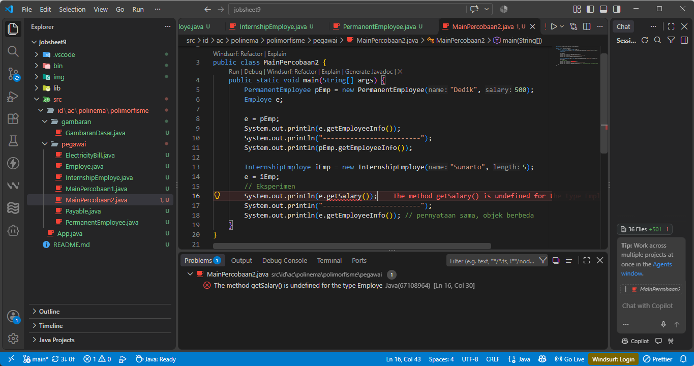

### 3. Source Code (`id.ac.polinema.polimorfisme.pegawai`)

**MainPercobaan2.java**
```java
package id.ac.polinema.polimorfisme.pegawai;

public class MainPercobaan2 {
    public static void main(String[] args) {
        PermanentEmployee pEmp = new PermanentEmployee("Dedik", 500);
        Employee e;
        
        e = pEmp;
        System.out.println(e.getEmployeeInfo());
        System.out.println("-------------------------");
        System.out.println(pEmp.getEmployeeInfo());
        
        InternshipEmployee iEmp = new InternshipEmployee("Sunarto", 5);
        e = iEmp;
        System.out.println("-------------------------");
        System.out.println(e.getEmployeeInfo()); // pernyataan sama, objek berbeda
        
        // Eksperimen
        // System.out.println(e.getSalary());
    }
}
```

---

## C. Percobaan 3: Heterogeneous Collection

### 1. Tabel Eksperimen
| Perubahan | Pesan Error |
|---|---|
| Aktifkan baris `Employee[] e2 = {pEmp, iEmp, eBill};` | **incompatible types:** ElectricityBill cannot be converted to Employee |

### 2. Screenshot Output & Error
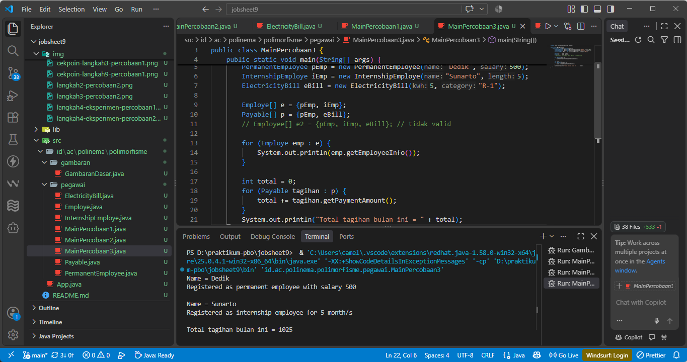
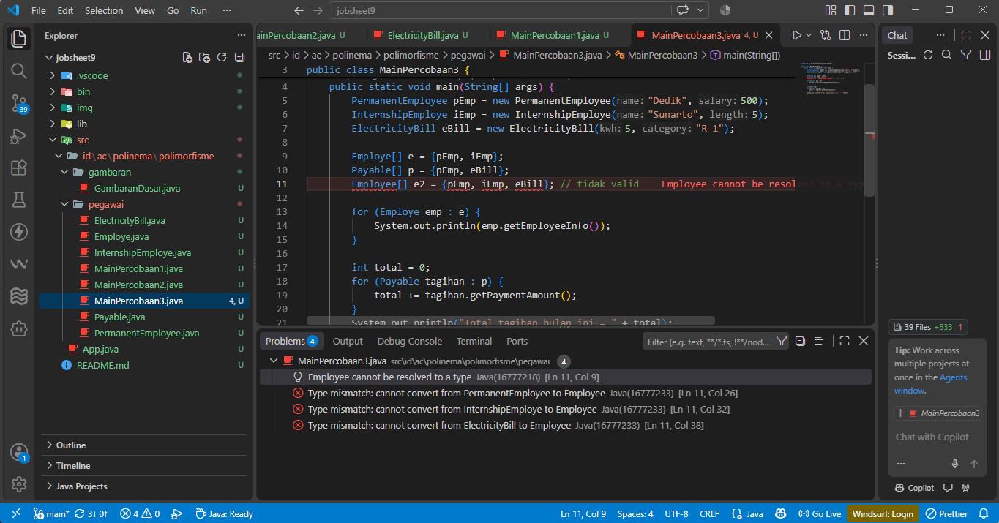

### 3. Source Code (`id.ac.polinema.polimorfisme.pegawai`)

**MainPercobaan3.java**
```java
package id.ac.polinema.polimorfisme.pegawai;

public class MainPercobaan3 {
    public static void main(String[] args) {
        PermanentEmployee pEmp = new PermanentEmployee("Dedik", 500);
        InternshipEmployee iEmp = new InternshipEmployee("Sunarto", 5);
        ElectricityBill eBill = new ElectricityBill(5, "R-1");
        
        Employee[] e = {pEmp, iEmp};
        Payable[] p = {pEmp, eBill};
        
        // Employee[] e2 = {pEmp, iEmp, eBill}; // tidak valid
        
        for (Employee emp : e) {
            System.out.println(emp.getEmployeeInfo());
        }
        
        int total = 0;
        for (Payable tagihan : p) {
            total += tagihan.getPaymentAmount();
        }
        System.out.println("Total tagihan bulan ini = " + total);
    }
}
```

---

## D. Percobaan 4: Polymorphic Argument, instanceof, dan Casting

### 1. Tabel Eksperimen
| Perubahan | Hasil |
|---|---|
| Tambahkan `ow.pay(iEmp);` | **Pesan error:** The method pay(Payable) in the type Owner is not applicable for the arguments (InternshipEmploye) |
| Buat dan jalankan class `Eksperimen4` | **Hasil:** Exception in thread "main" java.lang.ClassCastException: class InternshipEmployee cannot be cast to class PermanentEmployee |

### 2. Screenshot Output & Error
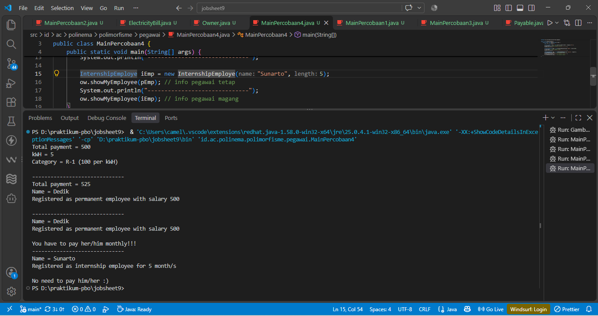
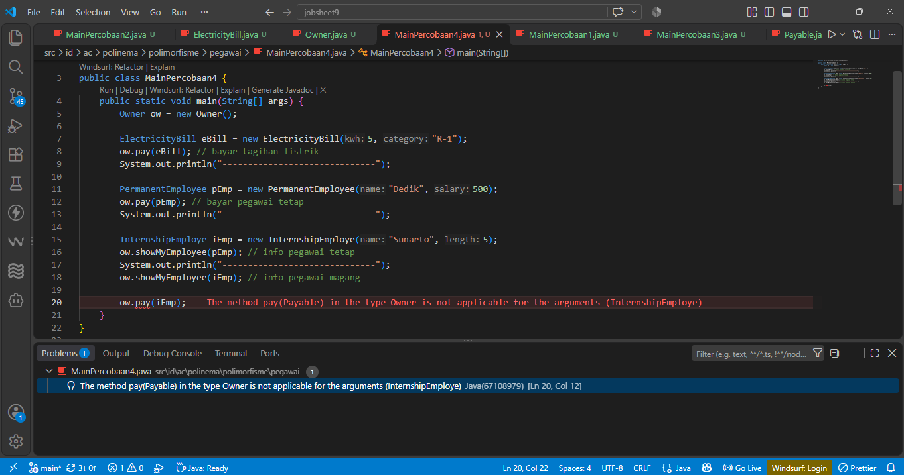
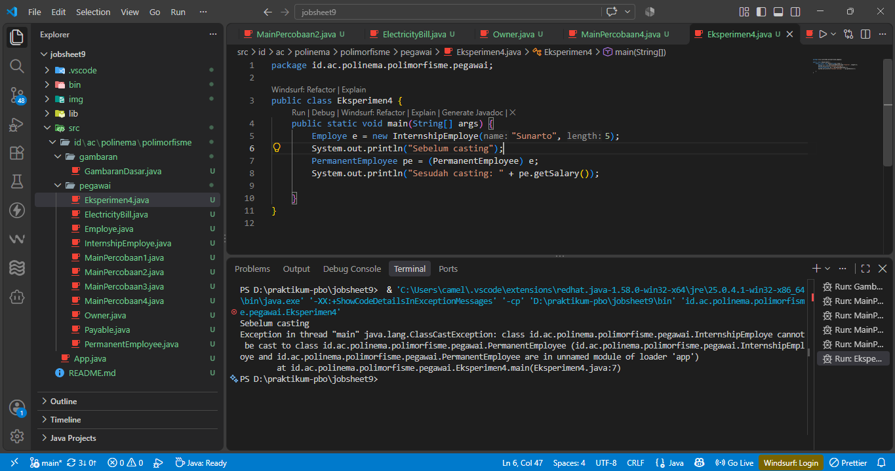

### 3. Source Code (`id.ac.polinema.polimorfisme.pegawai`)

**Owner.java**
```java
package id.ac.polinema.polimorfisme.pegawai;

public class Owner {
    public void pay(Payable p) {
        System.out.println("Total payment = " + p.getPaymentAmount());
        if (p instanceof ElectricityBill) {
            ElectricityBill eb = (ElectricityBill) p;
            System.out.println(eb.getBillInfo());
        } else if (p instanceof PermanentEmployee) {
            PermanentEmployee pe = (PermanentEmployee) p;
            System.out.println(pe.getEmployeeInfo());
        }
    }

    public void showMyEmployee(Employee e) {
        System.out.println(e.getEmployeeInfo());
        if (e instanceof PermanentEmployee) {
            System.out.println("You have to pay her/him monthly!!!");
        } else {
            System.out.println("No need to pay him/her :)");
        }
    }
}
```

---

## E. Tugas Mandiri

### Tugas 1 & 2: Permainan Zombie, Barrier, dan Plant
**Screenshot Output:**
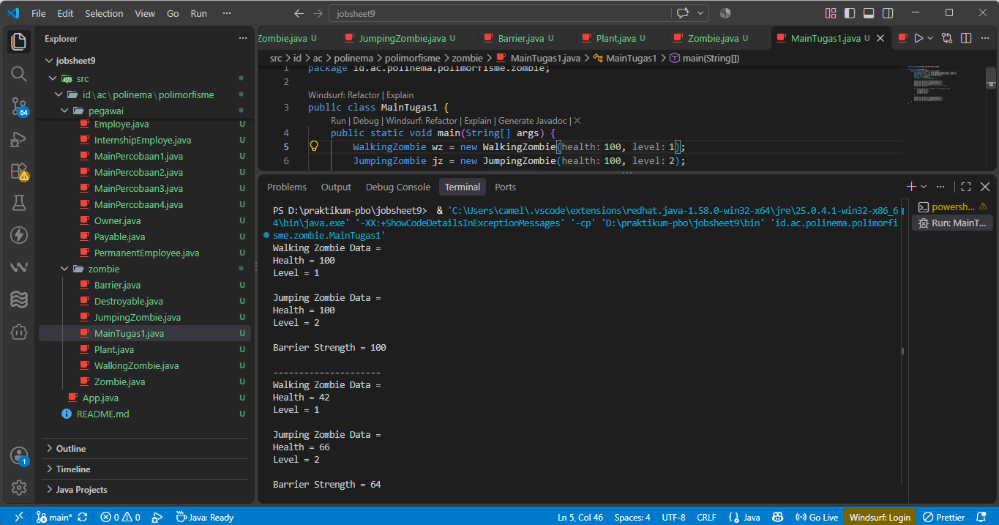
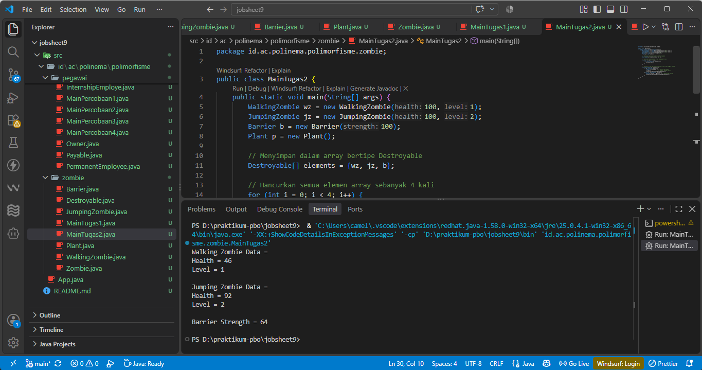

**Destroyable.java**
```java
package id.ac.polinema.polimorfisme.zombie;

public interface Destroyable {
    public void destroyed();
}

```

**Zombie.java**
```java
package id.ac.polinema.polimorfisme.zombie;

public abstract class Zombie implements Destroyable{
    protected int health;
    protected int level;

    public Zombie(int health, int level){
        this.health = health;
        this.level = level;
    }

    public abstract void heal();

    public abstract void destroyed();

    public String getZombieInfo(){
        return "Health = " + health + "\nLevel = " + level + "\n";
    }
    
}

```

**WalkingZombie.java**
```java
package id.ac.polinema.polimorfisme.zombie;

public class WalkingZombie extends Zombie{
    
    public WalkingZombie (int health, int level) {
        super(health, level);
    }

    @Override
    public void heal() {
        int bonus = 0;
        switch (level) {
            case 1:
                bonus = health * 10 / 100;
                break;
            case 2:
                bonus = health * 30 / 100;
                break;
            case 3:
                bonus = health * 40 / 100;
                break;
        }
        // Menambahkan bonus lalu membatasi maksimal health 100
        this.health = Math.min(this.health + bonus, 100);
    }

    @Override
    public void destroyed() {
        this.health -= this.health * 20 / 100;
    }

    @Override
    public String getZombieInfo() {
        return "Walking Zombie Data = \n" + super.getZombieInfo();
    }
}

```

**JumpingZombie.java**
```java
package id.ac.polinema.polimorfisme.zombie;

public class JumpingZombie extends Zombie {
    public JumpingZombie(int health, int level) {
        super(health, level);
    }

    @Override
    public void heal() {
        int bonus = 0;
        switch (level) {
            case 1:
                bonus = health * 30 / 100;
                break;
            case 2:
                bonus = health * 40 / 100;
                break;
            case 3:
                bonus = health * 50 / 100;
                break;
        }
        // Menambahkan bonus lalu membatasi maksimal health 100
        this.health = Math.min(this.health + bonus, 100);
    }  
        

        @Override
    public void destroyed() {
        this.health -= this.health * 10 / 100;
    }

    @Override
    public String getZombieInfo() {
        return "Jumping Zombie Data = \n" + super.getZombieInfo();
    }
}

```

**Barrier.java**
```java
package id.ac.polinema.polimorfisme.zombie;

public class Barrier implements Destroyable{
    private int strength;

    public Barrier(int strength) {
        this.strength = strength;
    }

    public int getStrength() {
        return strength;
    }

    public void setStrength(int strength) {
        this.strength = strength;
    }

    @Override
    public void destroyed() {
        this.strength = this.strength * 9 / 10;
    }

    public String getBarrierInfo() {
        return "Barrier Strength = " + this.strength + "\n";
    }
}

```

**Plant.java**
```java
package id.ac.polinema.polimorfisme.zombie;

public class Plant {
    public void doDestroy(Destroyable d) {
        d.destroyed();
    }
}

```

**MainTugas1.java**
```java
package id.ac.polinema.polimorfisme.zombie;

public class MainTugas1 {
    public static void main(String[] args) {
        WalkingZombie wz = new WalkingZombie(100, 1);
        JumpingZombie jz = new JumpingZombie(100, 2);
        Barrier b = new Barrier(100);
        Plant p = new Plant();
        //Zombie z = new Zombie(100, 1);

        System.out.println(wz.getZombieInfo());
        System.out.println(jz.getZombieInfo());
        System.out.println(b.getBarrierInfo());
        System.out.println("---------------------");

        for (int i = 0; i < 4; i++) { // hancurkan 4 kali
            p.doDestroy(wz);
            p.doDestroy(jz);
            p.doDestroy(b);
        }

        System.out.println(wz.getZombieInfo());
        System.out.println(jz.getZombieInfo());
        System.out.println(b.getBarrierInfo());
    }
}

```

**MainTugas2.java**
```java
package id.ac.polinema.polimorfisme.zombie;

public class MainTugas2 {
    public static void main(String[] args) {
        // Membuat objek sesuai ketentuan
        WalkingZombie wz = new WalkingZombie(100, 1);
        JumpingZombie jz = new JumpingZombie(100, 2);
        Barrier b = new Barrier(100);
        Plant p = new Plant();

        // Menyimpan dalam array bertipe Destroyable
        Destroyable[] elements = {wz, jz, b};

        // Hancurkan semua elemen array sebanyak 4 kali
        for (int i = 0; i < 4; i++) {
            for (Destroyable d : elements) {
                p.doDestroy(d);
            }
        }

        // Telusuri array, periksa instanceof, cast, dan panggil method
        for (Destroyable d : elements) {
            if (d instanceof Zombie) {
                Zombie z = (Zombie) d; // Casting ke Zombie
                z.heal();              // Panggil method heal()
                System.out.println(z.getZombieInfo());
            } else if (d instanceof Barrier) {
                Barrier barrier = (Barrier) d; // Casting ke Barrier
                System.out.println(barrier.getBarrierInfo());
            }
        }
    }
}
```

---

## F. Jawaban Pertanyaan

### Pertanyaan Percobaan 1
1. Class apa saja yang merupakan turunan dari class Employee?
**Class turunan Employee:** `InternshipEmployee` dan `PermanentEmployee`.
2. Class apa saja yang meng-implements interface Payable?
**Class implementor Payable:** `PermanentEmployee` dan `ElectricityBill`.
3. Pada `MainPercobaan1`, mengapa e dapat diisi dengan objek `pEmp``(PermanentEmployee)` dan `iEmp` `(InternshipEmployee)`?
**Mengapa `e` dapat diisi `pEmp` dan `iEmp`:** Karena tipe referensi `e` adalah `Employee`, sedangkan `pEmp` dan `iEmp` adalah subclass dari `Employee` (relasi *is-a*).
4. Pada MainPercobaan1, mengapa p dapat diisi dengan objek pEmp (PermanentEmployee) dan eBill (ElectricityBill)?
**Mengapa `p` dapat diisi `pEmp` dan `eBill`:** Karena tipe referensi `p` adalah antarmuka `Payable`, dan kedua objek tersebut (*PermanentEmployee* dan *ElectricityBill*) meng implementasi interface `Payable`.
5. Apa penyebab error pada p = iEmp; dan e = eBill;? Bandingkan dengan error pada
Vegetarian v2 = l;.
**Penyebab error `p = iEmp` dan `e = eBill`:** `InternshipEmployee` tidak meng implementasi `Payable`, sehingga tidak memenuhi kontrak. Sebaliknya, `ElectricityBill` bukanlah turunan dari `Employee`. Ini sama dengan percobaan Vegetarian di mana class `Lion` ditolak karena bukan merupakan implementasi antarmuka tersebut.
6. Pada GambaranDasar, variabel a bertipe Animal, tetapi getClass() menampilkan Deer. Apa beda tipe referensi dan tipe objek?
**Beda tipe referensi dan objek:** Tipe referensi adalah tipe yang dikenali oleh compiler saat penulisan kode (contoh: `Animal a`), sedangkan tipe objek adalah instansiasi aslinya di dalam memori saat aplikasi dijalankan (contoh: wujud aslinya `Deer`).
7. Ambil kesimpulan tentang konsep dan bentuk dasar polimorfisme.
**Kesimpulan polimorfisme:** Sebuah variabel bertipe *superclass* atau *interface* dapat digunakan secara fleksibel untuk merujuk dan menampung objek apapun yang merupakan *subclass* atau *implementor*nya.

### Pertanyaan Percobaan 2
1. Pada langkah 1, mengapa `e.getEmployeeInfo()` dan `pEmp.getEmployeeInfo()`
menghasilkan hasil yang sama?
Keduanya menghasilkan hal yang sama karena variabel `e` secara fisik menunjuk pada referensi memori objek `pEmp` yang persis sama.
2. Mengapa pemanggilan `e.getEmployeeInfo()` disebut pemanggilan method virtual,
sedangkan `pEmp.getEmployeeInfo()` tidak?
**perbedaan Virtual method dengan bukan Virtual method:** `e.getEmployeeInfo()` disebut virtual karena tipe referensinya (`Employe`) berbeda dengan tipe objek aslinya (`PermanentEmploye`). JVM secara virtual mencocokkan method pada saat *runtime*. Sedangkan `pEmp` memiliki tipe referensi dan objek yang sudah sama dari awal.
3. Jelaskan maksud virtual method invocation. Mengapa disebut virtual?
**Maksud Virtual Method Invocation:** Adalah roses di mana *compiler* Java menyerahkan keputusan eksekusi method hasil *overriding* kepada JVM untuk ditentukan saat program berjalan (runtime), murni berdasarkan wujud asli objek tersebut, bukan wujud tipe referensinya.
4. Pada langkah 3, mengapa pernyataan  `e.getEmployeeInfo()` yang sama menghasilkan
keluaran berbeda?
**Keluaran berbeda pada pernyataan yang sama:** Karena isi memori variabel `e` telah diubah untuk menunjuk ke referensi objek baru, yaitu `InternshipEmploye`.
5. Pada langkah 4, mengapa `e.getSalary()` ditolak compiler padahal objek yang ditunjuk e adalah `PermanentEmployee`?
Meskipun objek aslinya punya method itu, *compiler* Java hanya peduli pada tipe referensi `e` (yaitu `Employe`). Karena `Employe` tidak memiliki *method* `getSalary()`, *compiler* langsung menolaknya.

### Pertanyaan Percobaan 3
1. Mengapa array e dapat berisi objek `pEmp (PermanentEmployee)` dan `iEmp(InternshipEmployee)` yang bertipe berbeda?
Karena *array* tersebut bertipe *superclass* `Employee`, sehingga ia secara sah dapat menampung objek apapun yang merupakan kelas turunannya (heterogeneous collection).
2. Mengapa array p dapat berisi objek `pEmp (PermanentEmployee)` dan `eBill(ElectricityBill)` yang bertipe berbeda?
Sama halnya, array tipe *interface* `Payable` bebas diisi oleh objek dari *class* manapun asalkan *class* tersebut meng implements `Payable`.
3. Mengapa terjadi error pada `Employee[] e2 = {pEmp, iEmp, eBill};`?
Karena `eBill (ElectricityBill)` bukan merupakan *subclass* dari `Employee`.
4. Pada perulangan for (Employee emp : e), mengapa setiap elemen menghasilkan teks yang
berbeda padahal pemanggilannya sama? Hubungkan dengan Percobaan 2.
**Hasil perulangan beda padahal pemanggilan sama:** Ini adalah bentuk implementasi dari *Virtual Method Invocation*. Saat *looping*, JVM akan mengeksekusi `getEmployeeInfo()` versi spesifik sesuai wujud asli masing-masing objek yang ditarik dari *array* secara berurutan.

### Pertanyaan Percobaan 4
1. Pada `MainPercobaan4`, mengapa `ow.pay(eBill)` dan `ow.pay(pEmp)` dapat dilakukan, padahal parameter `pay()` bertipe `Payable`? Perhatikan bahwa `eBill` adalah `ElectricityBill` dan `pEmp` adalah `PermanentEmployee`.
**`ow.pay()` menerima parameter turunan:** Argumen method meminta `Payable`, dan berhubung `eBill` serta `pEmp` secara sah telah meng-implements `Payable`, maka keduanya memenuhi syarat *polymorphic argument*.
2. Apa tujuan membuat parameter bertipe Payable pada method `pay()` di class Owner?
Membuat satu *method* yang serbaguna (fleksibel). Pemilik perusahaan tidak perlu membuat method terpisah (seperti `payBill()` atau `payEmployee()`) selama benda tersebut dapat "dibayar".
3. Mengapa ow.pay(iEmp) menyebabkan error?
`ow.pay(iEmp)` error karena `InternshipEmployee` tidak mewarisi ataupun mengimplementasikan `Payable`. Pegawai magang tidak termasuk objek yang "dibayar" dalam sistem ini.
4. Pada Owner, untuk apa sintaks p instanceof ElectricityBill diperlukan?
**Tujuan `instanceof`:** Untuk memvalidasi dan memastikan dengan aman apakah wujud memori asli dari referensi abstrak `p` benar-benar sebuah `ElectricityBill` sebelum dilakukan *casting* atau manipulasi spesifik lainnya.
5. Pada `Owner`, untuk apa casting `(ElectricityBill) p` diperlukan? Mengapa objek `p` bertipe
Payable harus di cast ke `eb` bertipe `ElectricityBill`? Petunjuk: method apa yang dikenal
oleh tipe Payable?
**Casting ke `ElectricityBill` diperlukan:** Variabel abstrak `p` (bertipe `Payable`) hanya memiliki satu gerbang akses fungsi, yakni `getPaymentAmount()`. Untuk bisa memanggil fitur khusus seperti `getBillInfo()`, referensi tersebut wajib "diturunkan paksa" (*downcast*) ke wujud aslinya (`ElectricityBill`).
6. Pada Eksperimen4, mengapa kode lolos kompilasi tetapi gagal saat dijalankan? Bagaimana
instanceof mencegah kegagalan tersebut?
Kode lolos kompilasi karena Java mengizinkan *downcasting* selama alurnya memungkinkan, tetapi gagal saat dieksekusi (*ClassCastException*) karena memori objek aslinya terbukti berupa pegawai magang, bukan pegawai tetap. Kehadiran `instanceof` sebelum proses *casting* akan mendeteksi ketidakcocokan ini dan mencegah *error crash* (*exception*).

### Pertanyaan Analisis Tugas Mandiri
**Tugas 1:**
*   **(a)** Mengapa `Plant.doDestroy()` dapat menerima `WalkingZombie`, `JumpingZombie`, dan `Barrier` padahal ketiganya tidak berada dalam satu hierarki class?
Ketiga class tersebut mengimplementasikan interface yang sama, yaitu Destroyable. Method `doDestroy(Destroyable d)` pada class `Plant` menggunakan parameter polimorfik bertipe interface, sehingga objek apapun yang statusnya mengimplementasikan `Destroyable` sah untuk ditampung dan diterima sebagai argumen.

*   **(b)** Pada `d.destroyed()` di dalam `Plant`, apa tipe referensi dan tipe objek, dan versi `destroyed()` mana yang dijalankan untuk tiap pemanggilan di `MainTugas1`?
Tipe referensinya adalah *interface Destroyable*. Tipe objek yang sebenarnya berwujud `WalkingZombie`, `JumpingZombie`, dan `Barrier` secara berurutan menyesuaikan argumen yang dimasukkan. Berkat mekanisme virtual method invocation, compiler secara dinamis akan menjalankan versi method `destroyed()` hasil *override* milik masing-masing objek aslinya, bukan milik *interface* kosongnya.

*   **(c)** Apa yang terjadi bila Anda menulis `new Zombie(100, 1)`? Tuliskan pesan errornya.
Akan terjadi error kompilasi yang menolak baris kode tersebut karena class Zombie adalah sebuah abstract class. Aturan dasar OOP melarang sebuah kelas abstrak untuk diinstansiasi secara langsung dibuat objek fisiknya menggunakan new. Pesan error yang muncul di Java adalah: *Cannot instantiate the type Zombie*.
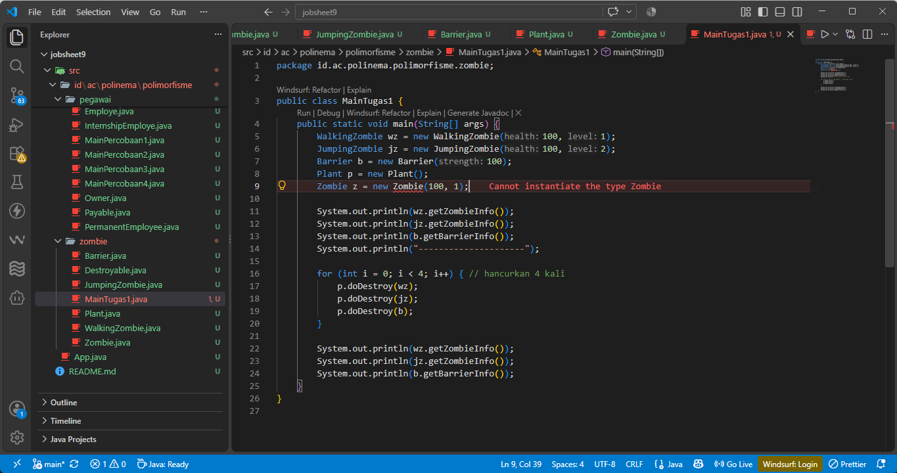

**Tugas 2:**
*   **(a) Mengapa array harus bertipe Destroyable, bukan Zombie?**
Karena array tersebut juga ditugaskan untuk menampung objek `Barrier`. `Barrier` bukanlah turunan *(subclass)* dari `Zombie`, melainkan entitas berbeda. Namun, `Barrier` dan `Zombie` sama-sama mengimplementasikan *interface* `Destroyable`. Jika array dideklarasikan bertipe `Zombie`, maka elemen `Barrier` tidak akan diizinkan masuk dan memicu *error* kompilasi.

*   **(b) Mengapa casting ke Zombie diperlukan sebelum memanggil heal()?**
Karena elemen saat di dalam array dibaca melalui tipe referensi *interface* `Destroyable`. *Interface* `Destroyable` hanya mendefinisikan method `destroyed()`, ia sama sekali tidak mengenali adanya method `heal()`. Agar *compiler* tahu bahwa kita ingin mengakses method `heal()` yang hanya dimiliki oleh class `Zombie`,yang harus dilakukan adalah downcasting secara eksplisit.

*   **(c) Apa yang terjadi bila pemeriksaan instanceof dihilangkan dan elemen Barrier di-cast ke Zombie?**
Program akan mengalami error saat dijalankan *(Runtime Error)* berupa *ClassCastException*. Karena objek aslinya di memori adalah `Barrier`, ia sama sekali tidak memiliki relasi pewarisan dengan Zombie sehingga tidak bisa dipaksa untuk dirubah wujudnya secara tiba-tiba.

### Tugas 3: Prediksi Hasil Kompilasi
| Pernyataan | Prediksi | Alasan |
|---|---|---|
| `Zombie z = new WalkingZombie(100, 1);` | **OK** | *Upcasting* standar dari *subclass* ke *superclass*. |
| `Destroyable d = z;` | **OK** | *Upcasting* karena `Zombie` resmi meng implements `Destroyable`. |
| `Zombie z2 = d;` | **Error Kompilasi** | *Downcasting* implisit dari *interface* kembali ke tipe *class* membutuhkan kurung eksplisit `(Zombie)`. |
| `Zombie z3 = (Zombie) d;` | **OK** | *Downcasting* dituliskan secara benar (eksplisit) dan aslinya `d` adalah Zombie. |
| `Zombie z4 = new Zombie(100, 1);` | **Error Kompilasi** | *Class* berlabel `abstract` dilarang diciptakan secara langsung di instansiasi pakai `new`. |
| `Destroyable d2 = new Plant();` | **Error Kompilasi** | Class `Plant` sama sekali tidak meng implements kontrak `Destroyable`. |
| `Zombie z5 = new JumpingZombie(100, 2);` | **OK** | *Upcasting* sah dari *subclass* spesifik ke *superclass*. |
| `WalkingZombie w = (WalkingZombie) z5;` | **Error Saat Dijalankan** | Lolos kompilasi tapi akan crash (*ClassCastException*). Secara esensi memori, `z5` adalah `JumpingZombie`, tidak bisa diubah jadi `WalkingZombie`. |

